# AgriTrace — Guide de formation par profil

> Support de formation animé en salle ou en autonomie, avec la **version de démonstration** (données fictives).
> Chaque module correspond à un profil de compte : objectifs, pas à pas, captures d'écran, exercices avec le résultat attendu.

## 1. Comment utiliser ce guide

1. Installez la version de démonstration (voir `docs/DEMO.md`) ou connectez-vous à l'instance fournie par le formateur.
2. Chaque stagiaire reçoit **un compte** correspondant à son futur poste (liste en section 3).
3. Suivez le module de votre profil, réalisez les exercices, cochez la liste « Acquis » en fin de module.
4. Les données sont **entièrement fictives** : on peut se tromper, annuler, recommencer. Le formateur peut réinstaller la démonstration à tout moment.

Les captures ont été prises sur la version de démonstration ; les libellés des boutons peuvent différer légèrement selon la version installée.

## 2. Niveaux de compte

| Niveau | Profils | Peut… | Ne peut pas… |
|---|---|---|---|
| **1 — Opérateur** | Magasinier, caissier, agent de terrain, cartographe, collecteur, coach, acheteur et exportateur (partenaires) | Saisir dans son périmètre, imprimer ses reçus, **demander** une annulation | Approuver une annulation, voir hors de son périmètre |
| **2 — Gestion** | Comptable, responsable magasin, traçabilité, cartographie, qualité, logistique | Valider, ajuster, contrôler dans son domaine | Approuver les prêts et les annulations (sauf droit explicite) |
| **3 — Pilotage / contrôle** | Direction, responsable financier, ADG, auditeur | Approuver (annulations, prêts, écarts), suivre toute l'activité ; l'auditeur lit seulement | Saisir au quotidien (hors responsable financier) |
| **4 — Administration** | Administrateur de la coopérative | Tout dans sa coopérative : comptes, rôles, profil, annulations | Voir les autres coopératives |

Principes communs, à répéter en formation :
- **Rien ne se supprime** : une erreur se corrige par une écriture ou un mouvement inverse, après approbation d'un supérieur.
- **Demandeur ≠ approbateur** : on ne valide jamais sa propre demande.
- **Tout est tracé** : chaque reçu imprimé, chaque décision et chaque réimpression (« duplicata »).
- **Hors connexion** : le téléphone enregistre localement et synchronise ensuite.

## 3. Comptes de la démonstration

Mot de passe commun : `Demo-AgriTrace-2026!` (à changer pour toute utilisation réelle).

| Profil | Utilisateur fictif | Identifiant |
|---|---|---|
| Administrateur de la coopérative | Adjoua Konan | `admin@demo.agritrace.test` |
| Magasinier | Mamadou Coulibaly | `magasinier@demo.agritrace.test` |
| Caissier / caissière | Aya Kouamé | `caissier@demo.agritrace.test` |
| Comptable | Salif Ouédraogo | `comptable@demo.agritrace.test` |
| Direction | Nathalie Boni | `direction@demo.agritrace.test` |
| Responsable traçabilité | Éric Tano | `responsable.tracabilite@demo.agritrace.test` |
| Responsable cartographie | Clarisse Ahoua | `responsable.cartographie@demo.agritrace.test` |
| Cartographe | Jean-Marc Gnahoré | `cartographe@demo.agritrace.test` |
| Agent de terrain | Rosine Yapi | `agent.terrain@demo.agritrace.test` |
| Responsable de magasin | Daouda Fofana | `responsable.magasin@demo.agritrace.test` |
| Responsable financier | Estelle Aké | `responsable.financier@demo.agritrace.test` |
| Responsable qualité | Hortense Zadi | `responsable.qualite@demo.agritrace.test` |
| Responsable logistique | Lassina Cissé | `responsable.logistique@demo.agritrace.test` |
| Auditeur (lecture seule) | Patrick Dago | `auditeur@demo.agritrace.test` |
| Acheteur / commercial | Fanta Kamara | `acheteur@demo.agritrace.test` |
| Collecteur (application téléphone) | Brahima Sylla | `collecteur@demo.agritrace.test` |
| Assistant de direction générale | Mireille Ouattara | `adg@demo.agritrace.test` |
| Coach / conseiller agricole | Gilbert Koffi | `coach@demo.agritrace.test` |
| Exportateur (partenaire) | Karim Diallo | `exportateur@demo.agritrace.test` |

## 4. Parcours conseillés

- **Chaîne d'achat** (demi-journée) : collecteur → magasinier → caissier → comptable → direction.
- **Contrôle et conformité** (demi-journée) : agent de terrain / cartographe → responsable cartographie → responsable traçabilité → qualité → ADG.
- **Pilotage** (2 h) : direction, responsable financier, auditeur, administrateur.

---

## 5. Administrateur de la coopérative

**Niveau 4 — Administration** · durée indicative : 3 h · compte de démonstration : `admin@demo.agritrace.test`

Responsable de la coopérative : crée les comptes, attribue les rôles, décide des annulations et programme les rapports.

### Objectifs

- Créer les comptes et attribuer les rôles types
- Renseigner le profil et le logo de la coopérative
- Traiter les demandes d'annulation
- Programmer l'envoi automatique de rapports
- Réinitialiser un mot de passe

### Ce que vous voyez

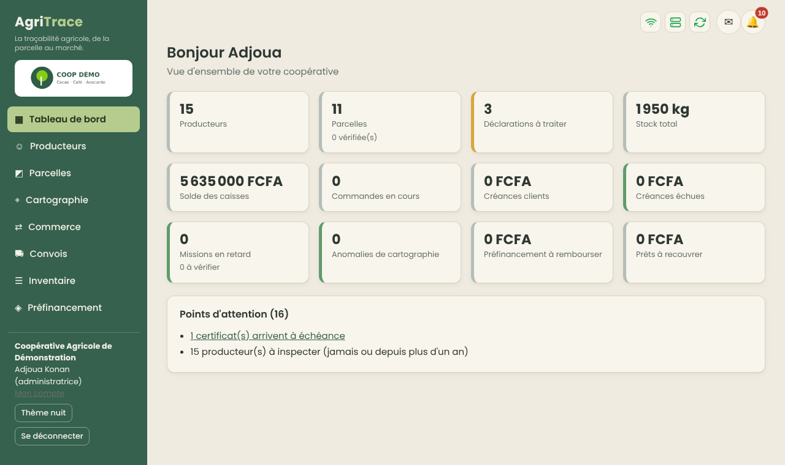

*Tableau de bord : les indicateurs affichés dépendent de vos droits.*

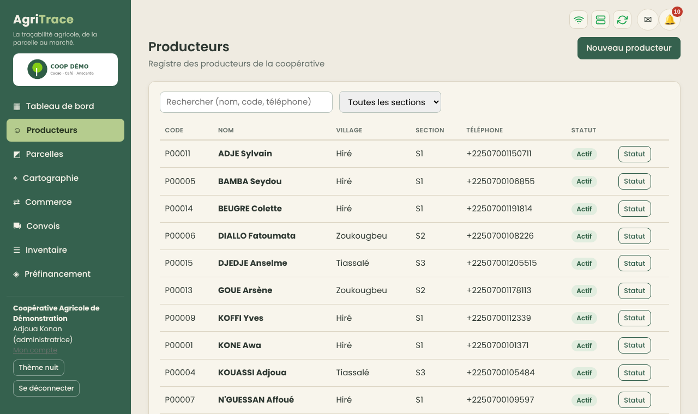

*Liste des producteurs de la coopérative.*

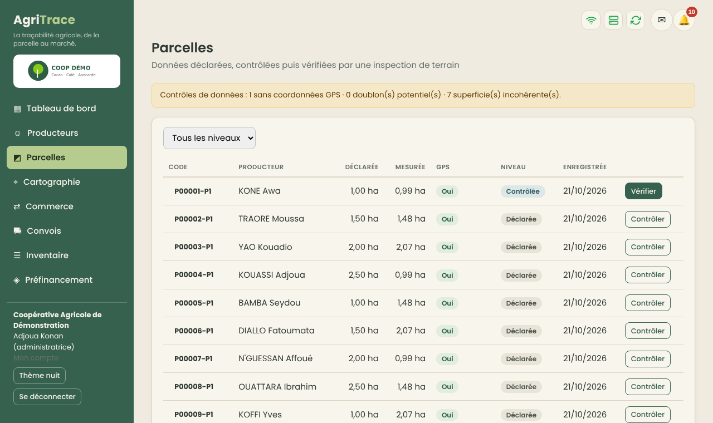

*Parcelles, superficies déclarées, état de vérification et versions du tracé.*

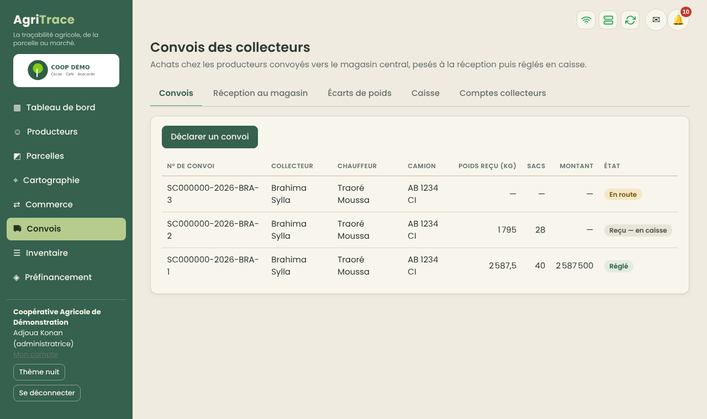

*Convois des collecteurs : en route, reçus au magasin, réglés en caisse.*

### Pas à pas

1. **Créer un compte.** Menu **Équipe** → section des utilisateurs → créer : nom, e-mail, mot de passe provisoire, **rôle**. Les modèles de rôles (magasinier, caissier…) évitent de cocher des droits un par un.
2. **Renseigner le profil.** Menu **Équipe** → *Profil de la coopérative* : nom commercial, adresse, téléphone, e-mail, devise. Ces informations figurent en tête des reçus imprimés. Ajoutez le **logo** (PNG ou JPEG, 1 Mo maximum).
3. **Traiter une annulation.** Menu **Mes opérations** → onglet *Demandes d'annulation* → **Traiter** : lisez le motif, puis approuvez ou refusez en justifiant. La personne qui a fait la demande ne peut pas l'approuver elle-même.
4. **Réinitialiser un mot de passe.** **Équipe** → utilisateur → *Réinitialiser le mot de passe*. Un mot de passe temporaire s'affiche **une seule fois** ; l'utilisateur devra en choisir un nouveau à la connexion.
5. **Programmer un rapport.** Menu **Rapports** → onglet *Envoi automatique* : choisissez le rapport, la fréquence et les destinataires (ils doivent avoir le droit de voir ce rapport).

### Exercices

| # | À faire | Résultat attendu |
|---|---|---|
| 1 | Créez un compte « Magasinier » pour un collègue fictif, connectez-vous avec, puis vérifiez les menus visibles. | Le menu ne contient ni Finances ni Équipe ; la première connexion impose le changement de mot de passe uniquement après une réinitialisation. |
| 2 | Approuvez la demande d'annulation de la réception SC000000-2026-BRA-2 (compte direction ou administrateur). | La réception passe en « annulée » ; une contre-passation apparaît dans le stock, l'original reste visible. |
| 3 | Programmez le rapport Finances chaque lundi pour le compte Direction. | La programmation apparaît dans la liste ; Direction reçoit une notification à chaque exécution. |

### Acquis (à cocher)

- [ ] Créer les comptes et attribuer les rôles types
- [ ] Renseigner le profil et le logo de la coopérative
- [ ] Traiter les demandes d'annulation
- [ ] Programmer l'envoi automatique de rapports
- [ ] Réinitialiser un mot de passe

---

## 6. Magasinier

**Niveau 1 — Opérateur** · durée indicative : 1 h 30 · compte de démonstration : `magasinier@demo.agritrace.test`

Réceptionne et pèse les convois au magasin central, tient les stocks et l'inventaire.

### Objectifs

- Réceptionner un convoi et peser
- Imprimer le reçu
- Demander l'annulation d'une réception faite par erreur
- Consulter les stocks

### Ce que vous voyez

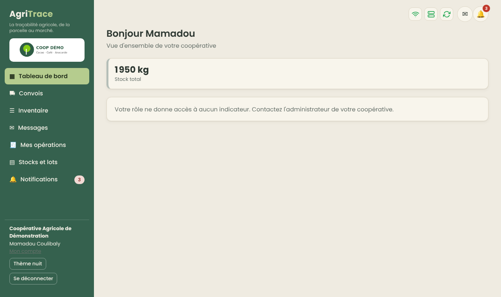

*Tableau de bord : les indicateurs affichés dépendent de vos droits.*

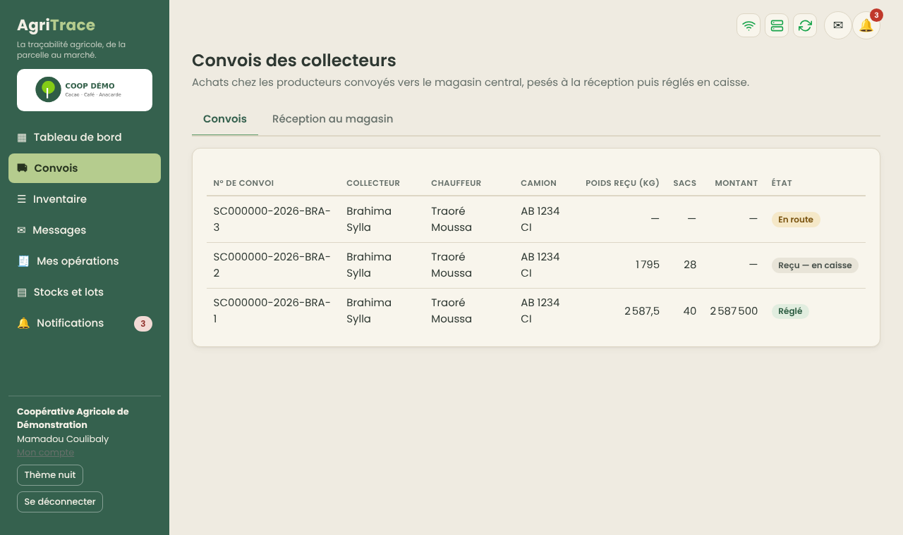

*Convois des collecteurs : en route, reçus au magasin, réglés en caisse.*

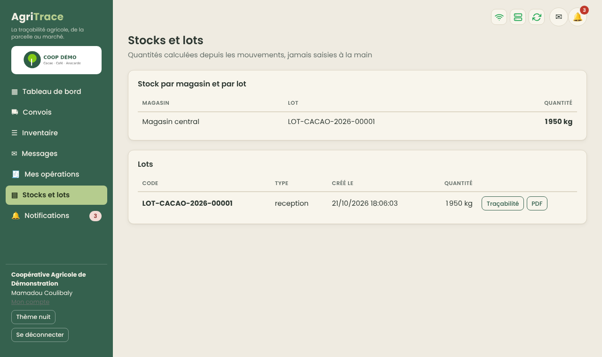

*Stocks par magasin et par lot, traçabilité du lot.*

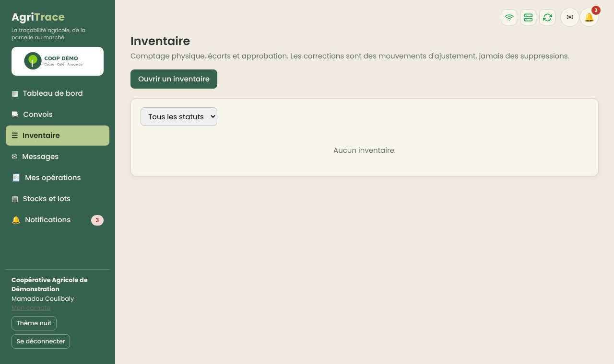

*Inventaires : comptage physique, écarts, approbation.*

### Pas à pas

1. **Voir les convois attendus.** Menu **Convois** → onglet *Réception au magasin* : les convois « en route » des collecteurs apparaissent.
2. **Réceptionner.** Choisissez le collecteur et le convoi, saisissez le **poids reçu** et le nombre de sacs, indiquez le magasin, puis validez. Le convoi passe à « Reçu — en caisse » et le stock est mis à jour.
3. **Imprimer le reçu.** Menu **Mes opérations** → ligne de l'opération → **Imprimer le reçu**. Une réimpression porte la mention *duplicata* et est tracée.
4. **Demander une annulation.** Dans **Mes opérations**, sur une opération erronée : demandez l'annulation en précisant le motif. Un responsable décidera ; vous suivez l'avancement dans l'onglet *Mes demandes*.

### Ce que ce profil ne voit pas

- Conformité / qualité
- Cartographie
- Caisse et comptabilité
- Finances
- Équipe
- Missions
- Préfinancement

### Exercices

| # | À faire | Résultat attendu |
|---|---|---|
| 1 | Réceptionnez le convoi SC000000-2026-BRA-3 (poids : 2 080 kg, 32 sacs). | Le convoi passe à « Reçu — en caisse » et le stock du lot augmente de 2 080 kg. |
| 2 | Imprimez le reçu de cette réception, puis réimprimez-le. | La seconde impression porte « duplicata ». |
| 3 | Demandez l'annulation de cette réception (motif : poids saisi par erreur). | La demande apparaît « en attente » ; l'opération reste valable tant qu'elle n'est pas approuvée. |

### Acquis (à cocher)

- [ ] Réceptionner un convoi et peser
- [ ] Imprimer le reçu
- [ ] Demander l'annulation d'une réception faite par erreur
- [ ] Consulter les stocks

---

## 7. Caissier

**Niveau 1 — Opérateur** · durée indicative : 1 h 30 · compte de démonstration : `caissier@demo.agritrace.test`

Traite les convois reçus, règle les collecteurs, tient la caisse et les comptes des collecteurs.

### Objectifs

- Traiter un convoi reçu (règlement du collecteur)
- Tenir la caisse (entrées/sorties) avec justificatif
- Consulter les comptes collecteurs
- Imprimer les reçus et demander une annulation

### Ce que vous voyez

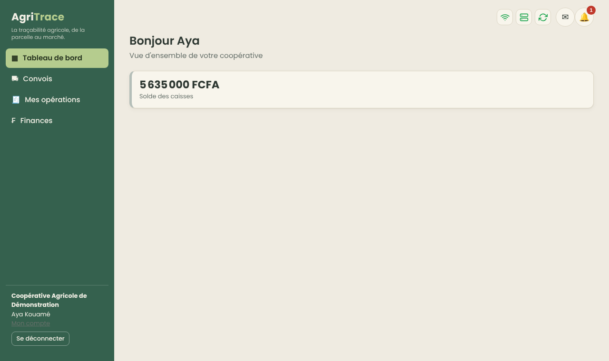

*Tableau de bord : les indicateurs affichés dépendent de vos droits.*

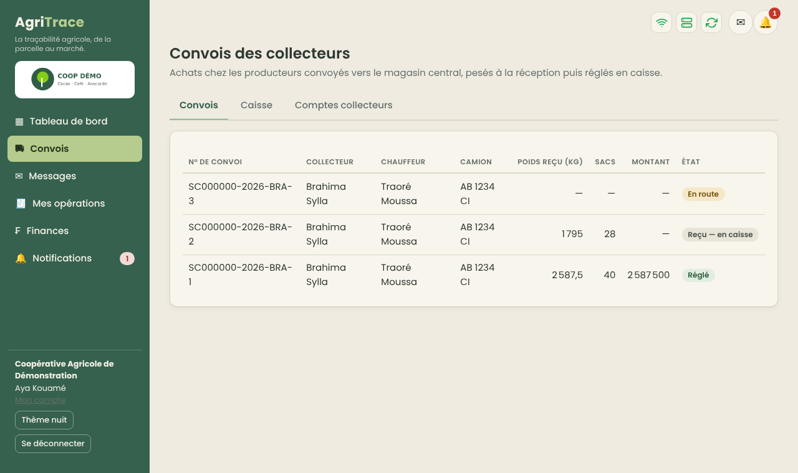

*Convois des collecteurs : en route, reçus au magasin, réglés en caisse.*

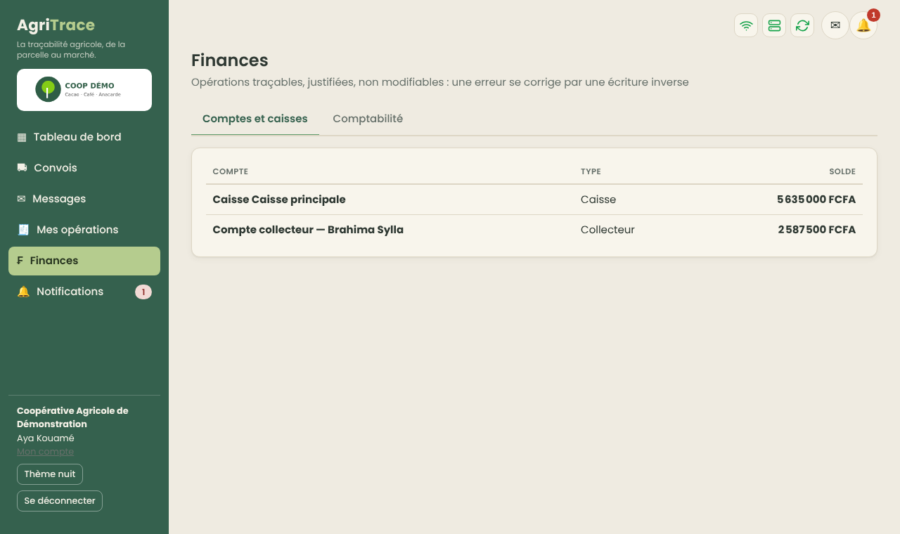

*Comptes, caisses et comptabilité (écritures non modifiables, corrigées par écriture inverse).*

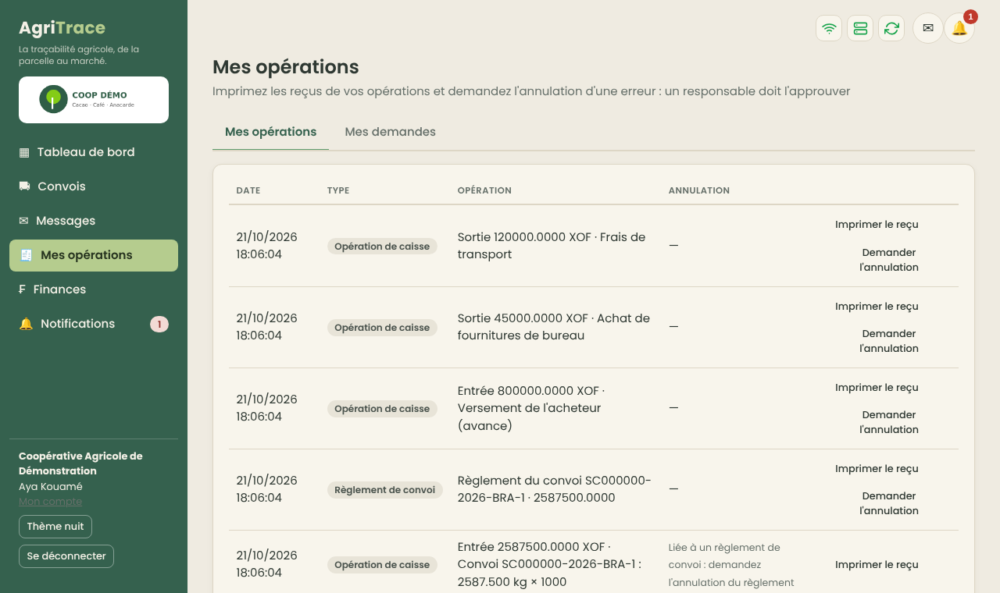

*Mes opérations : reçus à imprimer et demandes d'annulation.*

### Pas à pas

1. **Ouvrir la session de caisse.** Menu **Convois** → onglet *Caisse* : ouvrez la session avec le fonds de caisse initial.
2. **Régler un convoi.** Onglet *Convois* : sur un convoi « Reçu — en caisse », saisissez le **prix unitaire** du jour. Le montant = poids reçu × prix ; l'écriture de caisse et le compte du collecteur sont créés automatiquement.
3. **Saisir une opération de caisse.** Onglet *Caisse* : sens (entrée/sortie), montant, motif obligatoire. Aucune suppression possible : une erreur se corrige par une écriture inverse.
4. **Suivre les comptes collecteurs.** Onglet *Comptes collecteurs* : soldes, avances et retenues.

### Ce que ce profil ne voit pas

- Cartographie
- Conformité / qualité
- Équipe
- Missions
- Stocks

### Exercices

| # | À faire | Résultat attendu |
|---|---|---|
| 1 | Réglez le convoi SC000000-2026-BRA-3 (réceptionné par le magasinier à son exercice) au prix de 1 000 F/kg. | Montant = poids reçu × 1 000 (ex. 2 080 kg → 2 080 000 F) ; le convoi passe à « Réglé ». |
| 2 | Enregistrez une sortie de caisse de 15 000 F « Achat de papier ». | Le solde de la caisse diminue de 15 000 F ; l'opération est datée et attribuée à votre compte. |
| 3 | Imprimez le reçu de règlement. | Le reçu porte l'en-tête de la coopérative (nom, logo, adresse). |

### Acquis (à cocher)

- [ ] Traiter un convoi reçu (règlement du collecteur)
- [ ] Tenir la caisse (entrées/sorties) avec justificatif
- [ ] Consulter les comptes collecteurs
- [ ] Imprimer les reçus et demander une annulation

---

## 8. Comptable

**Niveau 2 — Gestion** · durée indicative : 2 h · compte de démonstration : `comptable@demo.agritrace.test`

Passe et consulte les écritures comptables, suit les comptes financiers ; peut demander l'annulation de ses écritures.

### Objectifs

- Passer des écritures comptables équilibrées
- Importer un relevé bancaire et pointer
- Demander l'annulation d'une écriture

### Ce que vous voyez

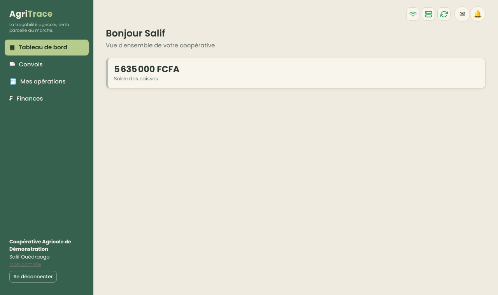

*Tableau de bord : les indicateurs affichés dépendent de vos droits.*

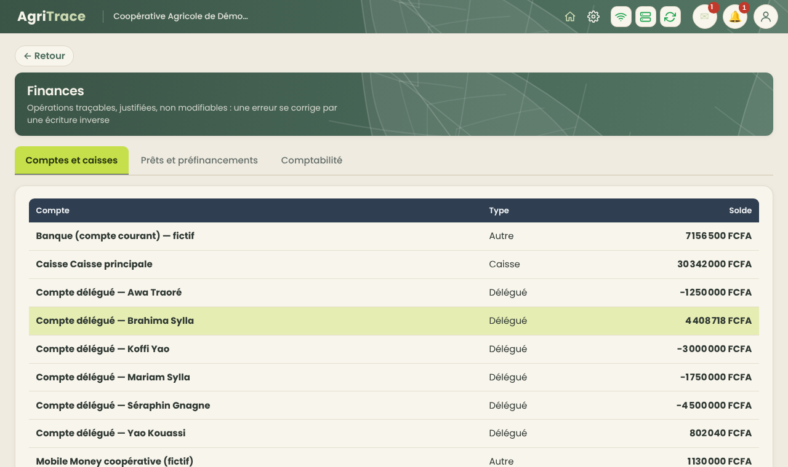

*Comptes, caisses et comptabilité (écritures non modifiables, corrigées par écriture inverse).*

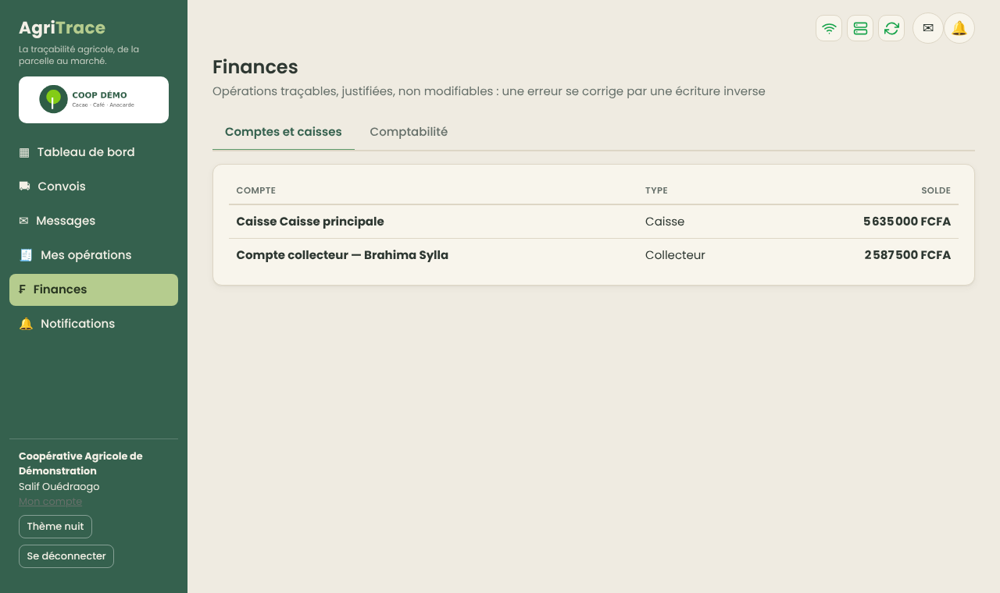

*Rapprochement bancaire : import du relevé (CSV) et pointage des opérations.*

### Pas à pas

1. **Passer une écriture.** Menu **Finances** → onglet *Comptabilité* → nouvelle écriture : journal, date, libellé, lignes (compte, débit ou crédit). Elle doit être **équilibrée**.
2. **Importer un relevé bancaire.** Onglet *Rapprochement bancaire* : choisissez le compte, le fichier CSV et associez les colonnes (date, libellé, débit, crédit). Utilisez d'abord la **simulation**.
3. **Pointer.** Les lignes évidentes sont pointées automatiquement (même sens, même montant, ±3 jours, un seul candidat). Pointez les autres à la main.

### Ce que ce profil ne voit pas

- Cartographie
- Conformité / qualité
- Équipe
- Missions
- Stocks

### Exercices

| # | À faire | Résultat attendu |
|---|---|---|
| 1 | Passez une écriture « Cotisation » : 571 Caisse au débit, 758 Produits divers au crédit, 20 000 F. | L'écriture apparaît au journal ; une écriture déséquilibrée est refusée. |
| 2 | Importez le relevé de démonstration en simulation puis pour de bon. | Les lignes sont pointées automatiquement ; les écarts restent « non rapprochés ». |

### Acquis (à cocher)

- [ ] Passer des écritures comptables équilibrées
- [ ] Importer un relevé bancaire et pointer
- [ ] Demander l'annulation d'une écriture

---

## 9. Direction

**Niveau 3 — Pilotage** · durée indicative : 1 h 30 · compte de démonstration : `direction@demo.agritrace.test`

Suit l'ensemble de l'activité (lecture) et approuve les demandes d'annulation, les prêts et les écarts.

### Objectifs

- Suivre l'activité (tableau de bord, rapports)
- Approuver ou refuser des demandes d'annulation
- Approuver un prêt

### Ce que vous voyez

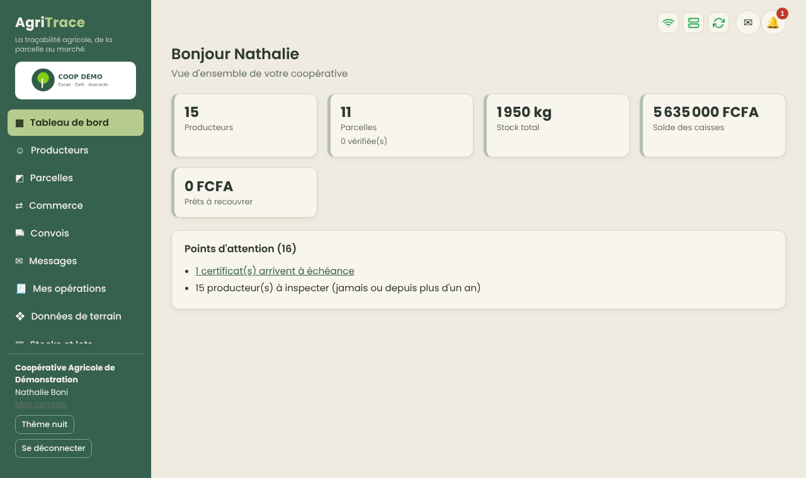

*Tableau de bord : les indicateurs affichés dépendent de vos droits.*

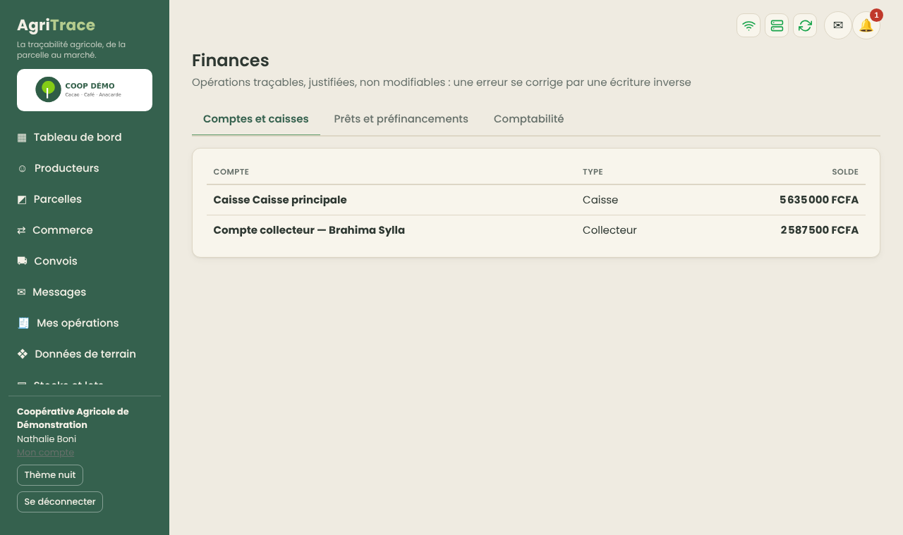

*Comptes, caisses et comptabilité (écritures non modifiables, corrigées par écriture inverse).*

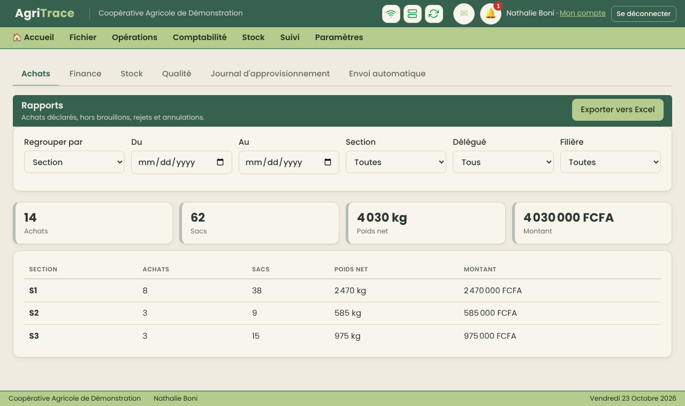

*Rapports et exports Excel.*

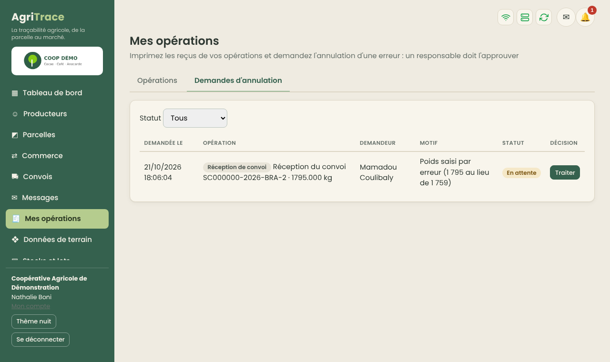

*Mes opérations : reçus à imprimer et demandes d'annulation.*

### Pas à pas

1. **Lire le tableau de bord.** Page d'accueil : stocks, finances, alertes selon vos droits.
2. **Décider d'une annulation.** Menu **Mes opérations** → *Demandes d'annulation* → **Traiter**. Vous ne pouvez pas décider de vos propres demandes.
3. **Approuver un prêt.** Menu **Préfinancement** (ou Finances) : ouvrez la demande, vérifiez l'échéancier, approuvez. Le demandeur ne peut pas approuver son propre prêt.

### Ce que ce profil ne voit pas

- Paramètres techniques

### Exercices

| # | À faire | Résultat attendu |
|---|---|---|
| 1 | Approuvez la demande d'annulation en attente de la réception SC000000-2026-BRA-2. | Statut « approuvée » ; le demandeur est notifié. |
| 2 | Ouvrez le rapport Finances et exportez-le vers Excel. | Un fichier .xlsx est téléchargé. |

### Acquis (à cocher)

- [ ] Suivre l'activité (tableau de bord, rapports)
- [ ] Approuver ou refuser des demandes d'annulation
- [ ] Approuver un prêt

---

## 10. Responsable financier

**Niveau 3 — Pilotage** · durée indicative : 2 h · compte de démonstration : `responsable.financier@demo.agritrace.test`

Supervise la caisse, les comptes et les prêts ; approuve les paiements, les corrections et les demandes d'annulation.

### Objectifs

- Superviser caisse et comptes
- Approuver et décaisser des prêts
- Décider des annulations

### Ce que vous voyez

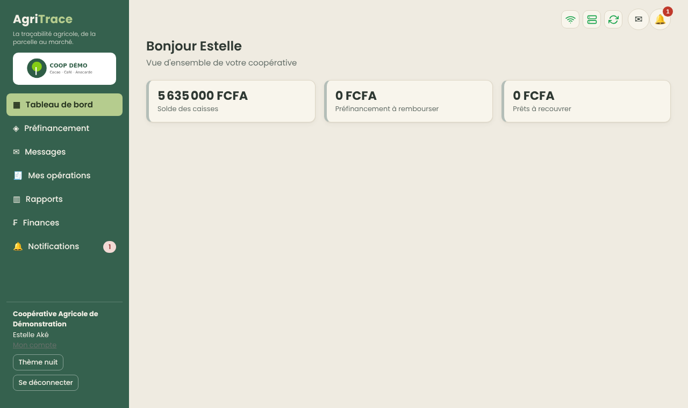

*Tableau de bord : les indicateurs affichés dépendent de vos droits.*

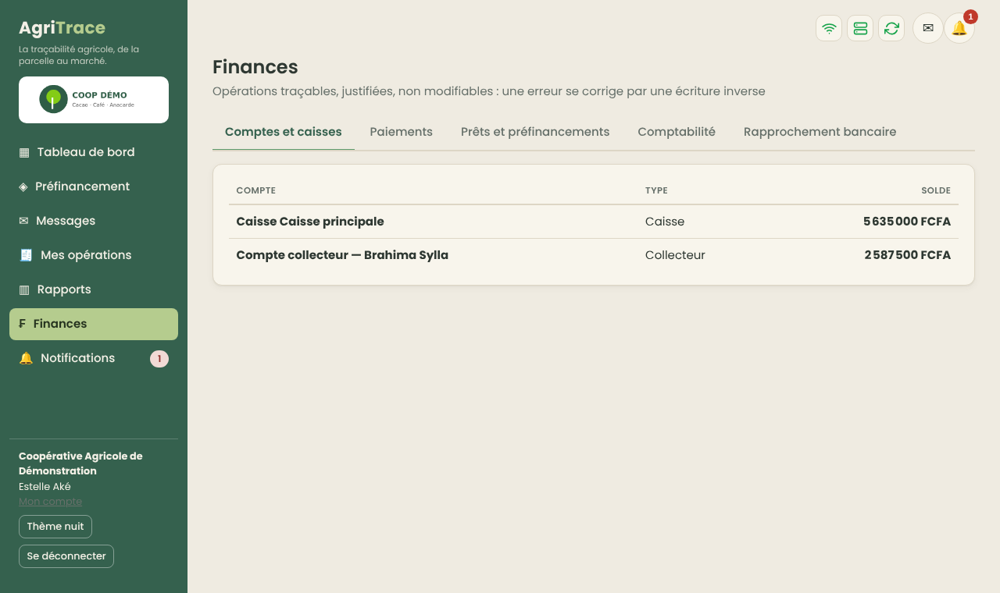

*Comptes, caisses et comptabilité (écritures non modifiables, corrigées par écriture inverse).*

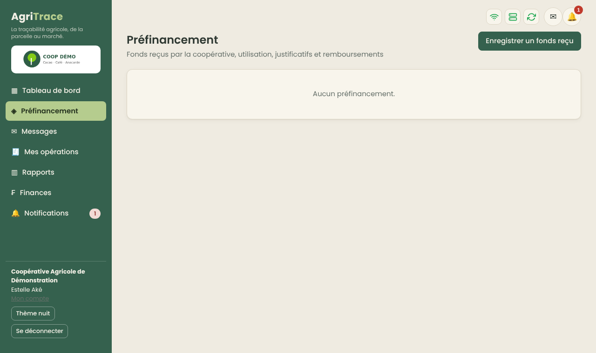

*Prêts et préfinancements : demande, approbation, décaissement, remboursements.*

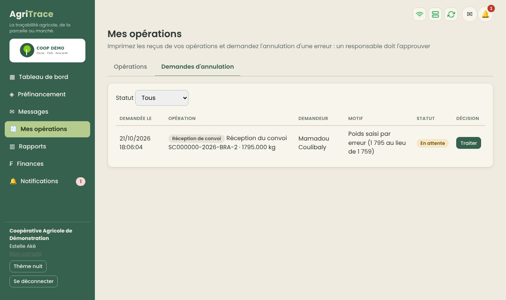

*Mes opérations : reçus à imprimer et demandes d'annulation.*

### Pas à pas

1. **Superviser la caisse.** Menu **Finances** : soldes des caisses et comptes, comptabilité, rapprochement.
2. **Approuver puis décaisser un prêt.** Menu **Préfinancement** : approbation avec échéancier, puis décaissement ; enregistrez les remboursements.
3. **Décider d'une annulation.** Menu **Mes opérations** → *Demandes d'annulation*.

### Ce que ce profil ne voit pas

- Cartographie
- Missions

### Exercices

| # | À faire | Résultat attendu |
|---|---|---|
| 1 | Approuvez la demande de prêt de KONE Awa (90 000 F) avec deux échéances. | Le prêt passe à « approuvé » ; l'échéancier est créé. |

### Acquis (à cocher)

- [ ] Superviser caisse et comptes
- [ ] Approuver et décaisser des prêts
- [ ] Décider des annulations

---

## 11. Responsable de magasin

**Niveau 2 — Gestion** · durée indicative : 1 h 30 · compte de démonstration : `responsable.magasin@demo.agritrace.test`

Gère les magasins, valide les inventaires et les écarts de pesée, ajuste les stocks.

### Objectifs

- Gérer les magasins
- Valider les inventaires et les écarts de pesée
- Ajuster un stock

### Ce que vous voyez

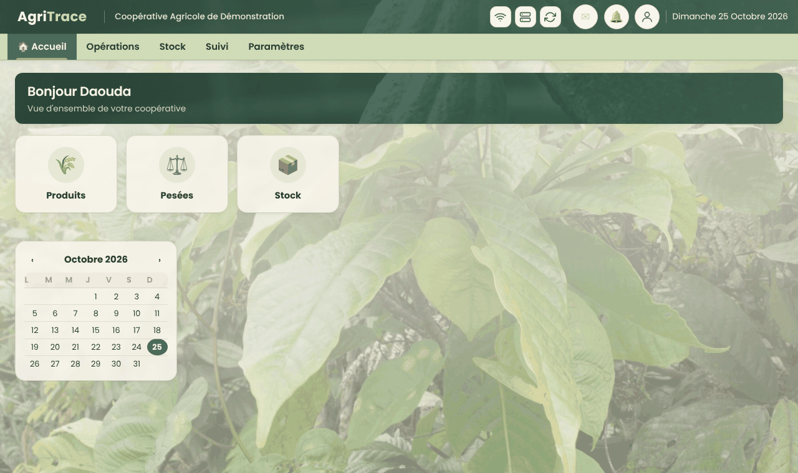

*Tableau de bord : les indicateurs affichés dépendent de vos droits.*

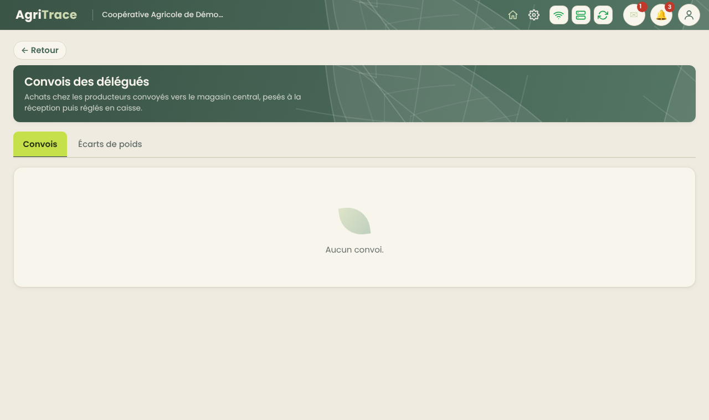

*Convois des collecteurs : en route, reçus au magasin, réglés en caisse.*

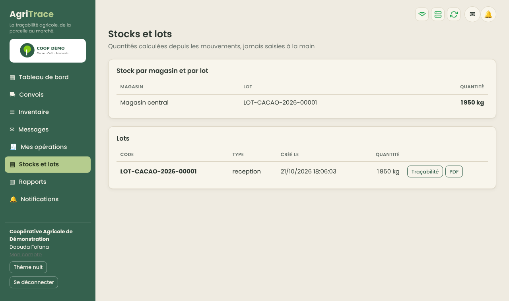

*Stocks par magasin et par lot, traçabilité du lot.*

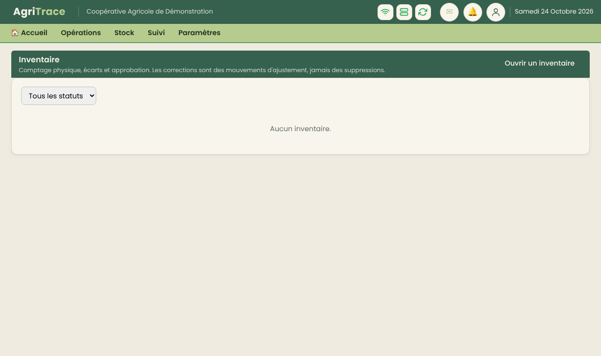

*Inventaires : comptage physique, écarts, approbation.*

### Pas à pas

1. **Ouvrir un inventaire.** Menu **Inventaire** → *Ouvrir un inventaire* : choisissez le magasin, saisissez les quantités comptées.
2. **Approuver les écarts.** Les écarts sont approuvés par vous ; une correction est un mouvement d'ajustement, jamais une suppression.

### Ce que ce profil ne voit pas

- Caisse et comptabilité
- Finances
- Cartographie

### Exercices

| # | À faire | Résultat attendu |
|---|---|---|
| 1 | Ouvrez un inventaire du Magasin central et comptez 1 940 kg. | Un écart de −10 kg apparaît, en attente d'approbation. |

### Acquis (à cocher)

- [ ] Gérer les magasins
- [ ] Valider les inventaires et les écarts de pesée
- [ ] Ajuster un stock

---

## 12. Responsable de traçabilité

**Niveau 2 — Gestion** · durée indicative : 1 h 30 · compte de démonstration : `responsable.tracabilite@demo.agritrace.test`

Valide les déclarations d'achat, suit les lots et les certificats, contrôle la chaîne de traçabilité.

### Objectifs

- Contrôler les déclarations d'achat
- Remonter la chaîne de traçabilité d'un lot
- Suivre les producteurs

### Ce que vous voyez

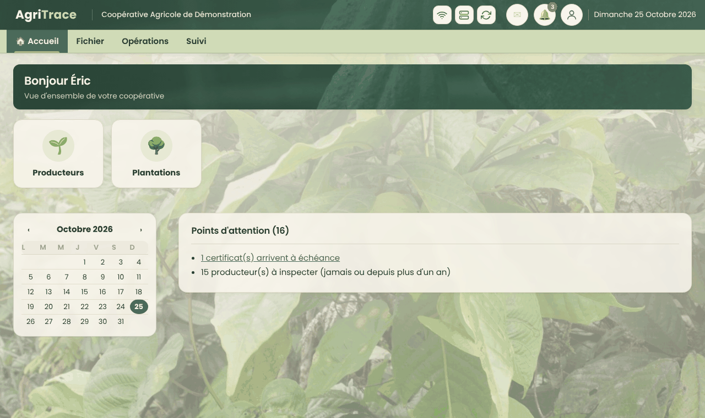

*Tableau de bord : les indicateurs affichés dépendent de vos droits.*

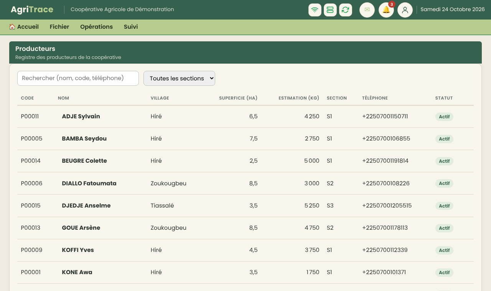

*Liste des producteurs de la coopérative.*

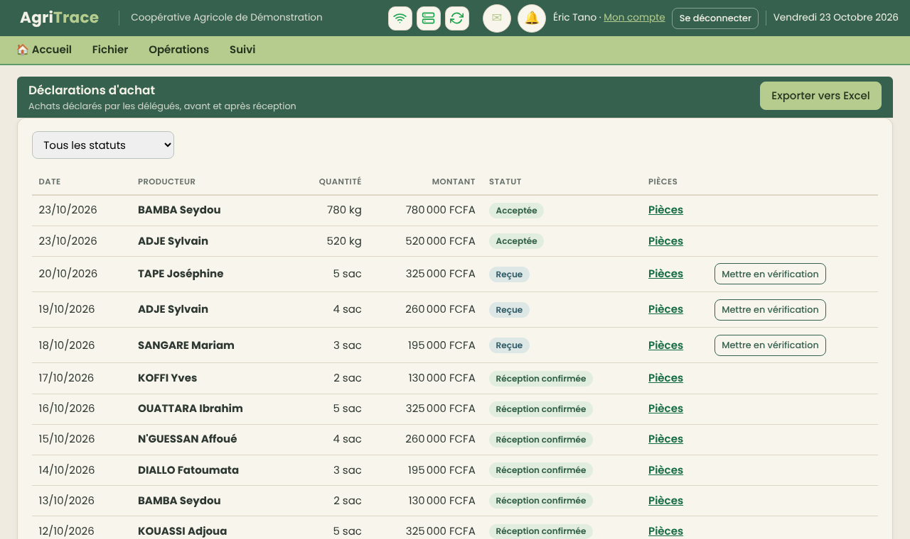

*Déclarations d'achat des collecteurs, à mettre en vérification puis valider.*

### Pas à pas

1. **Vérifier les déclarations.** Menu **Déclarations d'achat** : les déclarations « Reçue » attendent une mise en vérification, puis validation.
2. **Tracer un lot.** Menu **Stocks et lots** (si accessible) ou la fiche du lot : bouton *Traçabilité* pour voir producteurs, parcelles, convois et pesées.

### Ce que ce profil ne voit pas

- Caisse et comptabilité
- Finances

### Exercices

| # | À faire | Résultat attendu |
|---|---|---|
| 1 | Mettez en vérification la déclaration de TAPE Joséphine. | Son statut passe à « En vérification ». |
| 2 | Recherchez un reçu par numéro et retrouvez le producteur. | La fiche du producteur s'affiche avec ses parcelles. |

### Acquis (à cocher)

- [ ] Contrôler les déclarations d'achat
- [ ] Remonter la chaîne de traçabilité d'un lot
- [ ] Suivre les producteurs

---

## 13. Responsable cartographie

**Niveau 2 — Gestion** · durée indicative : 1 h 30 · compte de démonstration : `responsable.cartographie@demo.agritrace.test`

Vérifie les parcelles, traite les anomalies géographiques, gère les couches et les exports cartographiques.

### Objectifs

- Vérifier les parcelles et leurs tracés
- Traiter les anomalies géographiques
- Importer des couches de référence

### Ce que vous voyez

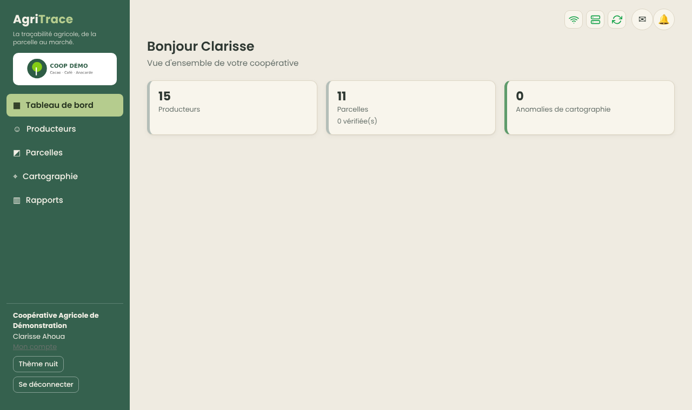

*Tableau de bord : les indicateurs affichés dépendent de vos droits.*

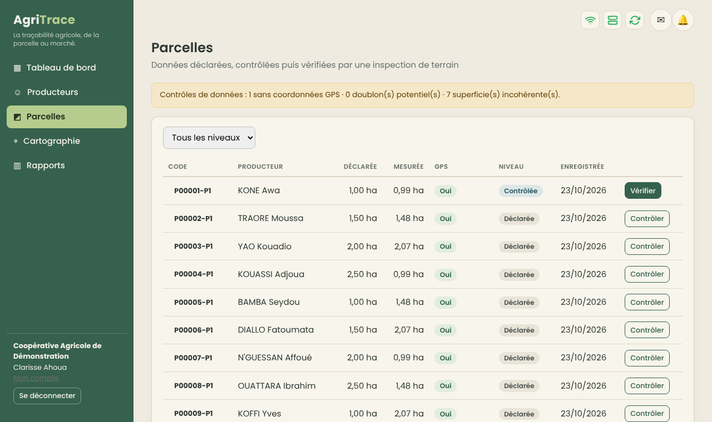

*Parcelles, superficies déclarées, état de vérification et versions du tracé.*

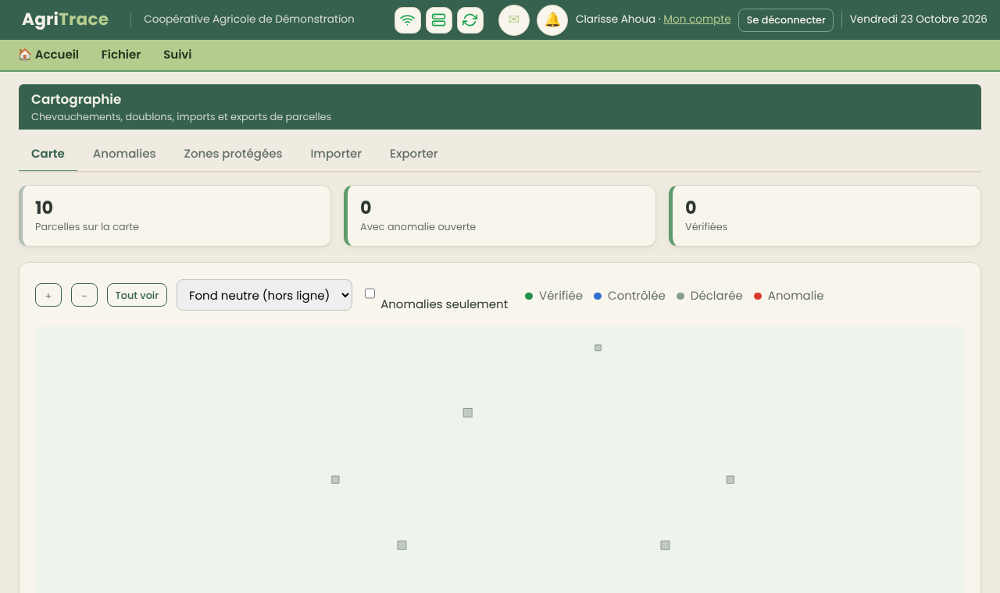

*Carte, anomalies géographiques et couches de référence.*

### Pas à pas

1. **Contrôler une parcelle.** Menu **Parcelles** : ouvrez la fiche, comparez la superficie déclarée à celle du tracé puis lancez le contrôle.
2. **Traiter les anomalies.** Menu **Cartographie** → onglet des anomalies : chevauchements, zones protégées, doublons. Décidez (corriger, justifier, rejeter).
3. **Consulter l'historique du tracé.** Dans la fiche de la parcelle : *Versions du tracé* (auteur, motif, date).

### Ce que ce profil ne voit pas

- Caisse et comptabilité
- Finances
- Stocks

### Exercices

| # | À faire | Résultat attendu |
|---|---|---|
| 1 | Contrôlez la parcelle de KONE Awa. | Le statut de contrôle est mis à jour. |
| 2 | Repérez sur la carte une parcelle sans tracé. | La parcelle de ADJE Sylvain n'a pas de tracé : elle est signalée. |

### Acquis (à cocher)

- [ ] Vérifier les parcelles et leurs tracés
- [ ] Traiter les anomalies géographiques
- [ ] Importer des couches de référence

---

## 14. Cartographe

**Niveau 1 — Opérateur** · durée indicative : 1 h · compte de démonstration : `cartographe@demo.agritrace.test`

Relève et saisit les parcelles, importe les tracés, consulte les anomalies.

### Objectifs

- Saisir ou importer le tracé d'une parcelle
- Consulter les anomalies

### Ce que vous voyez

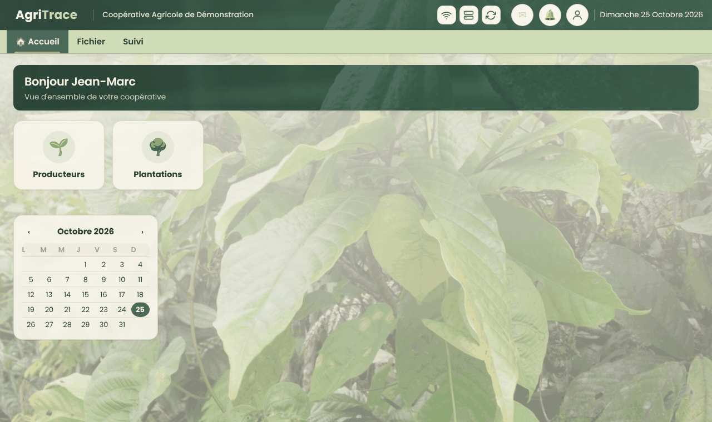

*Tableau de bord : les indicateurs affichés dépendent de vos droits.*

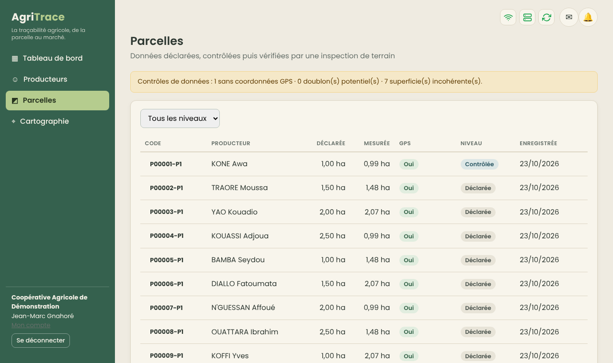

*Parcelles, superficies déclarées, état de vérification et versions du tracé.*

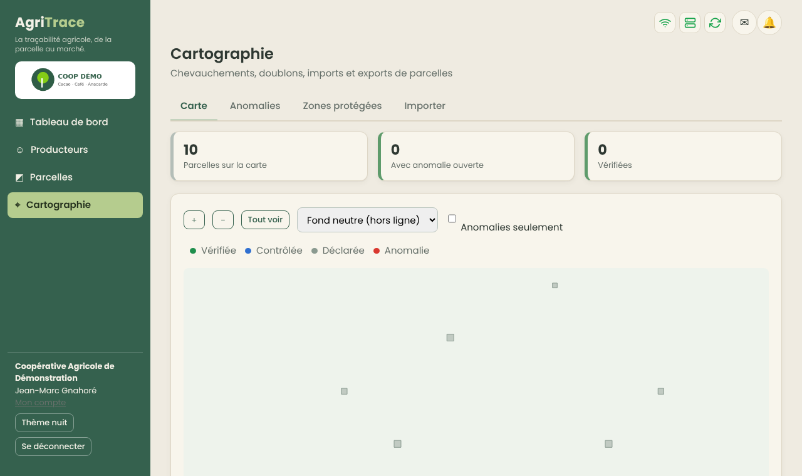

*Carte, anomalies géographiques et couches de référence.*

### Pas à pas

1. **Créer une parcelle.** Menu **Parcelles** → nouvelle parcelle : producteur, filière, superficie déclarée, tracé (ou import de fichier).
2. **Corriger un tracé.** Modifiez le tracé depuis la fiche ; l'ancienne version est conservée dans *Versions du tracé*.

### Ce que ce profil ne voit pas

- Caisse et comptabilité
- Finances
- Stocks
- Équipe

### Exercices

| # | À faire | Résultat attendu |
|---|---|---|
| 1 | Ajoutez le tracé de la parcelle de ADJE Sylvain. | La parcelle n'est plus signalée « sans tracé ». |

### Acquis (à cocher)

- [ ] Saisir ou importer le tracé d'une parcelle
- [ ] Consulter les anomalies

---

## 15. Agent de terrain

**Niveau 1 — Opérateur** · durée indicative : 1 h 30 · compte de démonstration : `agent.terrain@demo.agritrace.test`

Enregistre les producteurs et les données de terrain, exécute les missions qui lui sont confiées.

### Objectifs

- Enregistrer un producteur
- Exécuter une mission
- Saisir un relevé de terrain (même hors connexion)

### Sur le téléphone

<table class="phones"><tr><td>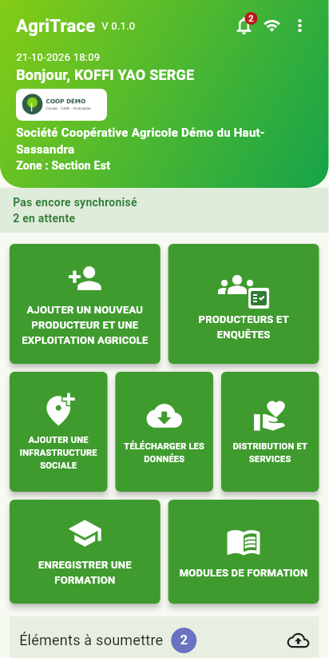</td><td>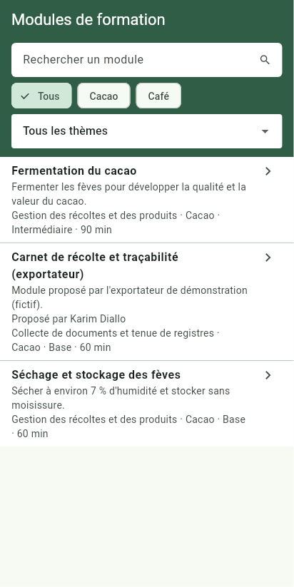</td><td>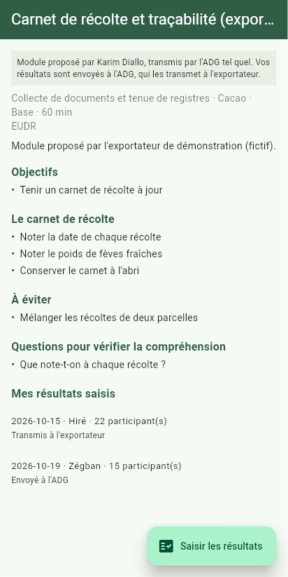</td><td>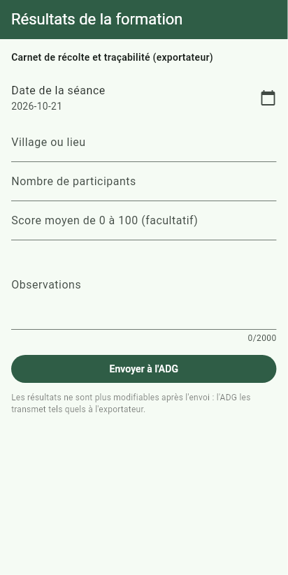</td></tr></table>

### Pas à pas

1. **Se connecter.** **Application mobile uniquement** : ce compte est refusé sur le portail web (message « Ce compte se connecte uniquement par l'application mobile »).
2. **Enregistrer un producteur.** Application → **Producteurs** → nouveau : nom, prénoms, village, section, téléphone, filière. Recherche par nom ou code et filtre par section.
3. **Exécuter une mission.** Fiche du producteur → onglet **Tâches** : suivez les instructions, joignez des preuves (photos). Une tâche terminée et validée par l'ADG est grisée, non cliquable, puis disparaît de la liste après le délai fixé par l'ADG.
4. **Saisir un relevé.** Formation, infrastructure sociale ou distribution. La saisie fonctionne hors connexion et se synchronise ensuite.

### Ce que ce profil ne voit pas

- Caisse et comptabilité
- Finances
- Stocks
- Équipe

### Exercices

| # | À faire | Résultat attendu |
|---|---|---|
| 1 | Enregistrez un nouveau producteur fictif dans le village de Hiré. | Il apparaît dans la liste, filière Cacao. |
| 2 | Exécutez la mission « Visite de la parcelle de Awa KONE ». | La mission passe en attente de validation ; une fois validée par l'ADG, elle est grisée dans la liste. |

### Acquis (à cocher)

- [ ] Enregistrer un producteur
- [ ] Exécuter une mission
- [ ] Saisir un relevé de terrain (même hors connexion)

---

## 16. Responsable qualité

**Niveau 2 — Gestion** · durée indicative : 1 h 30 · compte de démonstration : `responsable.qualite@demo.agritrace.test`

Gère les contrôles qualité, les inspections et les documents de conformité.

### Objectifs

- Définir des règles de qualité
- Réaliser une inspection
- Suivre les certificats

### Ce que vous voyez

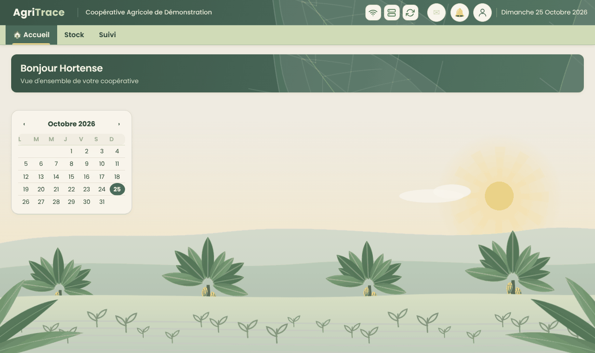

*Tableau de bord : les indicateurs affichés dépendent de vos droits.*

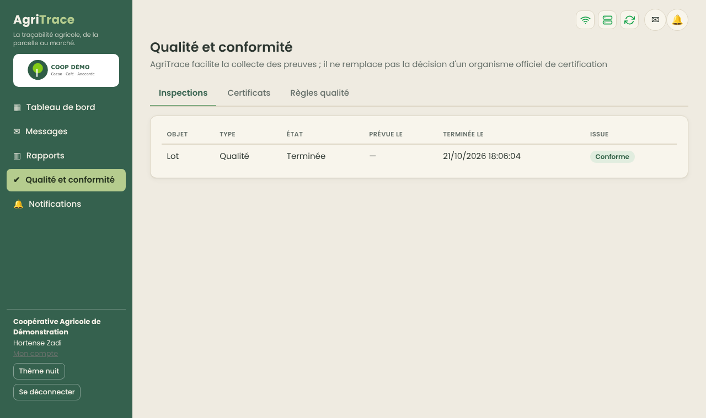

*Qualité : règles, inspections, certificats.*

### Pas à pas

1. **Définir une règle.** Menu **Qualité** → règles : code, libellé, seuil (ex. humidité ≤ 8 %), bloquante ou non.
2. **Inspecter un lot.** Créez une inspection sur le lot, démarrez-la, saisissez les résultats puis terminez avec un résumé.

### Ce que ce profil ne voit pas

- Caisse et comptabilité
- Finances

### Exercices

| # | À faire | Résultat attendu |
|---|---|---|
| 1 | Inspectez le lot LOT-CACAO-2026-00001 avec une humidité de 9,1 %. | Le résultat est non conforme (seuil 8 %) et bloquant. |

### Acquis (à cocher)

- [ ] Définir des règles de qualité
- [ ] Réaliser une inspection
- [ ] Suivre les certificats

---

## 17. Responsable logistique

**Niveau 2 — Gestion** · durée indicative : 1 h · compte de démonstration : `responsable.logistique@demo.agritrace.test`

Planifie les transports et les expéditions, suit les documents d'export.

### Objectifs

- Suivre les expéditions et commandes
- Consulter les stocks et documents d'export

### Ce que vous voyez

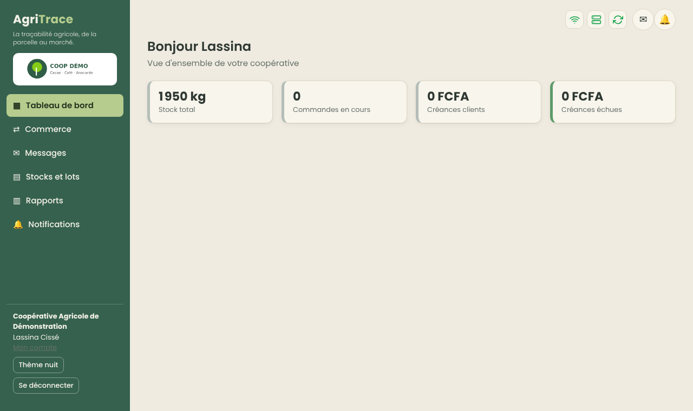

*Tableau de bord : les indicateurs affichés dépendent de vos droits.*

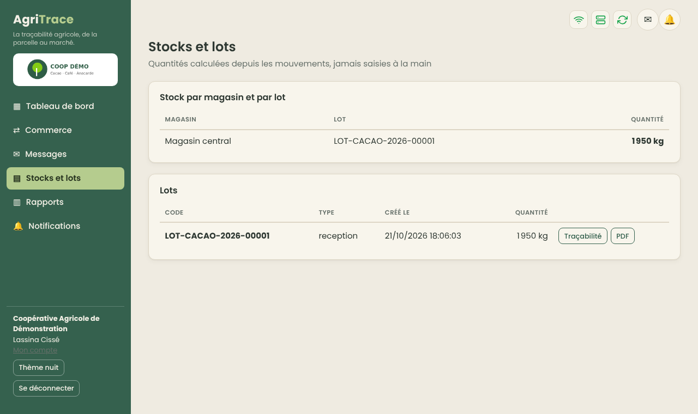

*Stocks par magasin et par lot, traçabilité du lot.*

### Pas à pas

1. **Suivre les commandes.** Commandes et expéditions selon vos droits ; documents joints aux dossiers d'export.

### Ce que ce profil ne voit pas

- Caisse et comptabilité
- Cartographie

### Exercices

| # | À faire | Résultat attendu |
|---|---|---|
| 1 | Repérez la commande de démonstration et son acheteur. | Le contrat CT-DEMO-001 et la commande associée sont visibles. |

### Acquis (à cocher)

- [ ] Suivre les expéditions et commandes
- [ ] Consulter les stocks et documents d'export

---

## 18. Auditeur

**Niveau 3 — Contrôle** · durée indicative : 1 h · compte de démonstration : `auditeur@demo.agritrace.test`

Consulte en lecture seule les opérations, les journaux d'audit et les états comptables ; ne modifie rien.

### Objectifs

- Consulter sans rien modifier
- Retrouver un fait dans le journal d'audit

### Ce que vous voyez

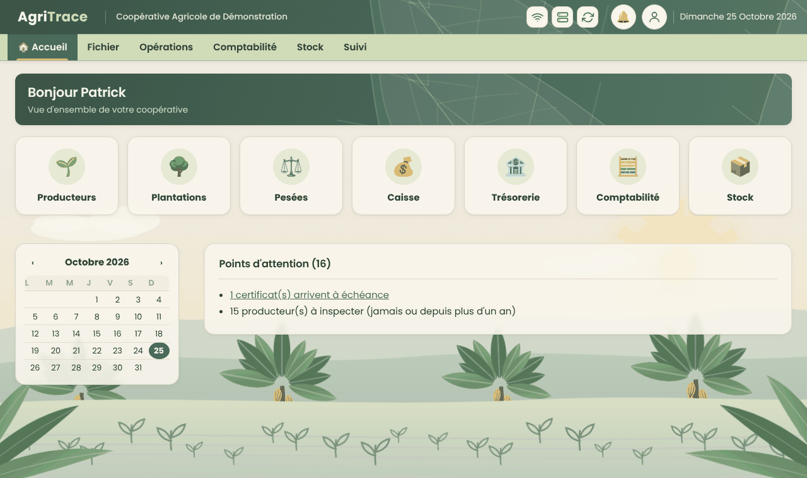

*Tableau de bord : les indicateurs affichés dépendent de vos droits.*

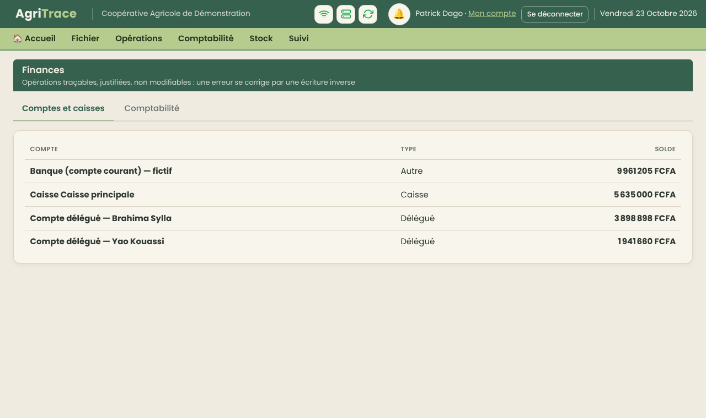

*Comptes, caisses et comptabilité (écritures non modifiables, corrigées par écriture inverse).*

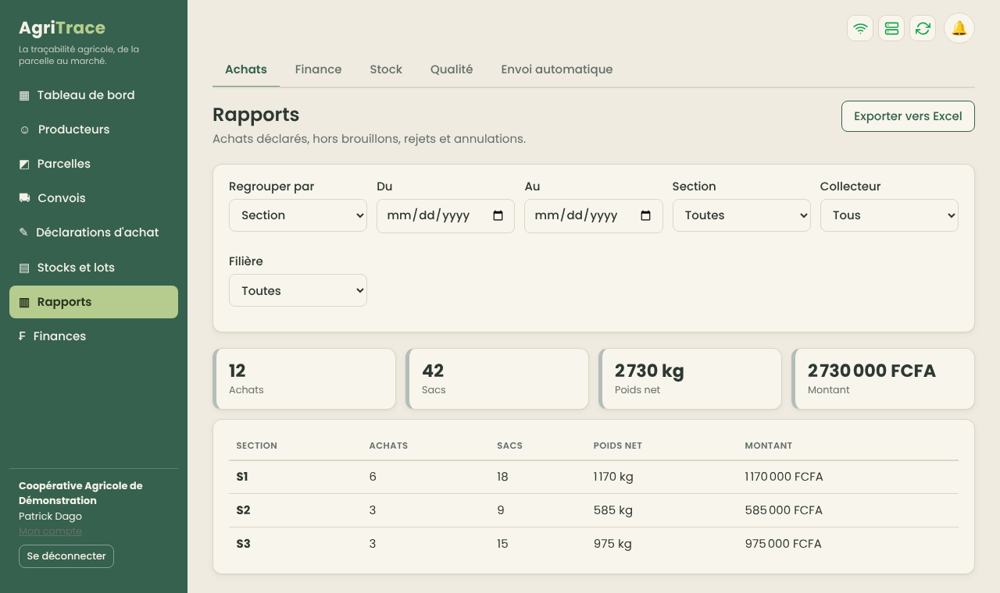

*Rapports et exports Excel.*

### Pas à pas

1. **Naviguer en lecture seule.** Tous les écrans sont consultables ; aucun bouton de saisie n'est proposé.
2. **Exporter un rapport.** Menu **Rapports** : export Excel pour vos propres analyses.

### Ce que ce profil ne voit pas

- Tout ce qui permet de saisir ou de modifier

### Exercices

| # | À faire | Résultat attendu |
|---|---|---|
| 1 | Tentez de modifier une écriture comptable. | Impossible : aucun bouton de modification n'est offert. |

### Acquis (à cocher)

- [ ] Consulter sans rien modifier
- [ ] Retrouver un fait dans le journal d'audit

---

## 19. Acheteur / partenaire externe

**Niveau 1 — Partenaire externe** · durée indicative : 45 min · compte de démonstration : `acheteur@demo.agritrace.test`

Partenaire autorisé : consulte les commandes, les expéditions et les documents qui le concernent.

### Objectifs

- Consulter ses commandes, expéditions et documents

### Ce que vous voyez

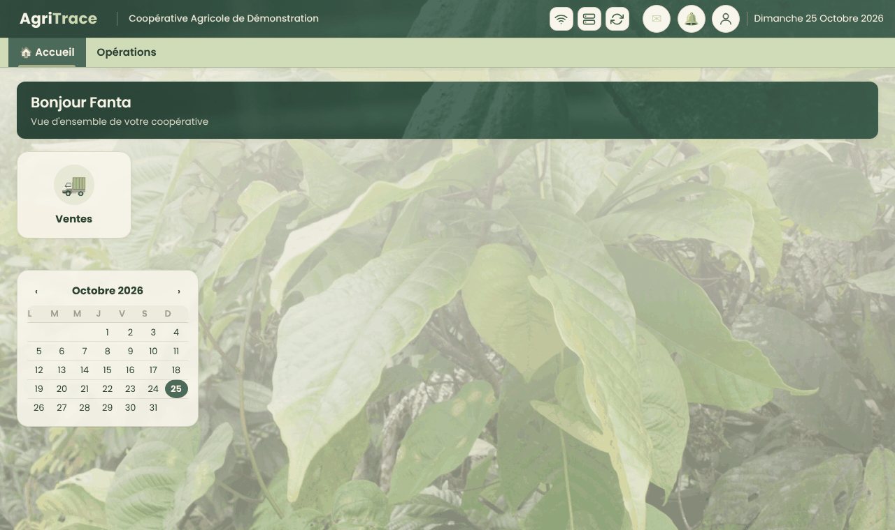

*Tableau de bord : les indicateurs affichés dépendent de vos droits.*

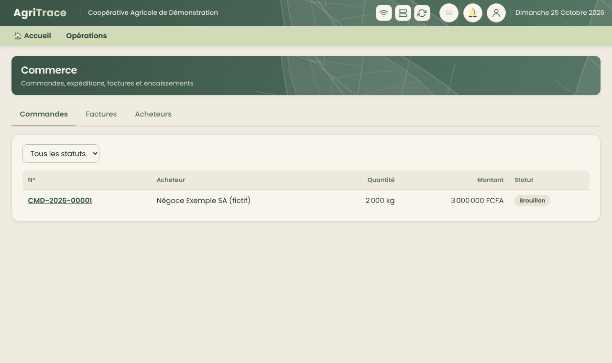

*Commerce : acheteurs, contrats, commandes.*

### Pas à pas

1. **Consulter ses commandes.** Menu **Commerce** : seules vos commandes et vos documents sont visibles.

### Ce que ce profil ne voit pas

- Tout sauf ses commandes, expéditions et documents

### Exercices

| # | À faire | Résultat attendu |
|---|---|---|
| 1 | Ouvrez la commande de démonstration. | Vous voyez la ligne « Cacao fèves — 2 000 kg ». |

### Acquis (à cocher)

- [ ] Consulter ses commandes, expéditions et documents

---

## 20. Collecteur (délégué)

**Niveau 1 — Opérateur** · durée indicative : 2 h · compte de démonstration : `collecteur@demo.agritrace.test`

Déclare ses achats chez les producteurs et ses convois, voit son stock, son historique et sa fiche de compte.

### Objectifs

- Déclarer un achat chez un producteur
- Créer un convoi
- Consulter son stock et sa fiche de compte

### Sur le téléphone

<table class="phones"><tr><td>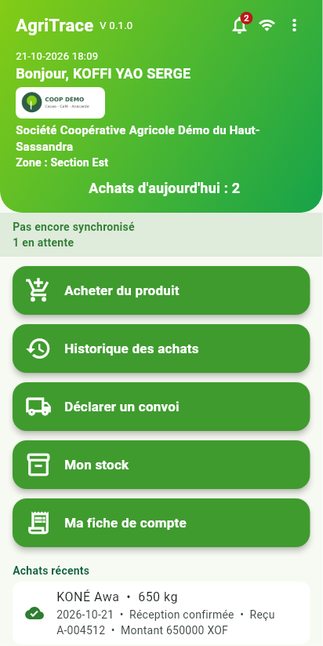</td><td></td><td></td><td></td></tr></table>

### Pas à pas

1. **Se connecter.** **Application mobile uniquement** : ce compte est refusé sur le portail web.
2. **Déclarer un achat.** Sur le téléphone : **Nouvel achat** → choisir le producteur → quantité, unité, sacs. L'achat se synchronise dès que le réseau est disponible.
3. **Créer un convoi.** Sur le téléphone : **Convoi** → chauffeur, camion, sacs et poids annoncés. Le **numéro de connaissement est attribué par le logiciel** : `code CCC de la coopérative` - `année` - `3 premières lettres du nom du collecteur` - `n° d'ordre` (ex. `SC000000-2026-BRA-1`). Hors connexion, le numéro définitif est attribué à l'envoi.
4. **Suivre son stock et son compte.** Sur le téléphone : *Mon stock*, *Historique* et *Fiche de compte*.

### Ce que ce profil ne voit pas

- Tout ce qui concerne les autres collecteurs
- Caisse
- Comptabilité
- Équipe

### Exercices

| # | À faire | Résultat attendu |
|---|---|---|
| 1 | Déclarez un achat de 3 sacs chez TRAORE Moussa. | L'achat apparaît « Soumis » dans Mes achats. |
| 2 | Créez un convoi (28 sacs, 1 800 kg annoncés) sans saisir de numéro. | Le logiciel attribue le numéro : code CCC, année, 3 premières lettres de votre nom, n° d'ordre (ex. SC000000-2026-BRA-1 pour le 1er convoi de Brahima). Le convoi apparaît « En route » côté magasin. |

### Acquis (à cocher)

- [ ] Déclarer un achat chez un producteur
- [ ] Créer un convoi
- [ ] Consulter son stock et sa fiche de compte

---

## 21. Administrateur de groupe (ADG)

**Niveau 3 — Pilotage** · durée indicative : 2 h · compte de démonstration : `adg@demo.agritrace.test`

Responsable de la conformité et de la certification : suit les certificats, les inspections et la qualité, contrôle et vérifie les parcelles, met en place les missions des coachs et décide de leurs demandes.

### Objectifs

- Suivre la conformité et les certificats
- Mettre en place les missions des coachs
- Décider de leurs demandes

### Ce que vous voyez

*Tableau de bord : les indicateurs affichés dépendent de vos droits.*

*Modules de formation : bibliothèque préchargée (cacao puis café), à conserver, modifier ou supprimer.*

*Modules des exportateurs : propositions à transmettre aux coachs, ou suivi de ses propres propositions.*

*Résultats saisis par les coachs, à transmettre à l'exportateur.*

### Pas à pas

1. **Suivre les certificats.** Rapports et alertes : le certificat de démonstration expire dans moins de 30 jours.
2. **Créer et affecter une mission.** Menu **Missions** : titre, catégorie, priorité, échéance, producteur, coach assigné, critères de validation ; publiez.
3. **Valider le résultat.** Revoyez les preuves transmises par le coach puis validez ou demandez une correction. Une tâche validée est grisée ; elle disparaît de la liste après le nombre de jours réglé en haut de la page *Missions* (« Jours de visibilité des missions validées », 7 par défaut).
4. **Transmettre les modules des exportateurs.** Menu **Modules des exportateurs** → onglet *Propositions* : lisez le module puis cliquez **Transmettre aux coachs** (ou **Décliner**, avec un motif facultatif). Le contenu est transmis **tel que proposé** : l'ADG ne peut pas le modifier. Le module apparaît alors dans la bibliothèque des coachs, marqué « Proposé par … ».
5. **Transmettre les résultats à l'exportateur.** Onglet *Résultats* : les coachs envoient d'abord leurs résultats à l'ADG (date, village, participants, score moyen, observations). Cliquez **Transmettre à l'exportateur** : les résultats sont transmis **tels que saisis**, sans modification possible.
6. **Gérer les modules de formation.** Menu **Modules de formation** : une bibliothèque agricole (cacao en priorité, puis café) liée aux certifications est préchargée. Pour chaque module : *Conserver* (validé tel quel), *Modifier* ou *Supprimer*. *Rétablir les modules par défaut* ne rajoute que les modules supprimés. Le contenu fourni est un socle général : adaptez-le à votre cahier des charges de certification.

### Ce que ce profil ne voit pas

- Caisse et comptabilité
- Finances
- Convois (réception et règlement)
- Stocks
- Préfinancement

### Exercices

| # | À faire | Résultat attendu |
|---|---|---|
| 1 | Créez une mission de formation et assignez-la au coach. | Le coach la voit dans ses missions (application mobile). |
| 2 | Dans **Modules des exportateurs**, transmettez la proposition en attente aux coachs, puis transmettez à l'exportateur le résultat reçu du coach. | La proposition passe « Transmise aux coachs » ; le résultat est marqué « Transmis ». Aucun champ n'a été modifié. |
| 3 | Dans **Modules de formation**, modifiez un module cacao puis supprimez un module café. | Le module modifié est marqué « Modifié » ; le coach ne voit plus le module supprimé après actualisation. |

### Acquis (à cocher)

- [ ] Suivre la conformité et les certificats
- [ ] Mettre en place les missions des coachs
- [ ] Décider de leurs demandes

---

## 22. Coach

**Niveau 1 — Opérateur** · durée indicative : 2 h · compte de démonstration : `coach@demo.agritrace.test`

Agent de terrain suivi par l'ADG : exécute ses missions, enregistre des producteurs, relève des parcelles, des infrastructures sociales, des formations et des distributions, joint des photos et demande de nouvelles missions.

### Objectifs

- Exécuter ses missions
- Rechercher et filtrer les producteurs par section
- Consulter les modules de formation
- Enregistrer producteurs, parcelles et relevés

### Sur le téléphone

<table class="phones"><tr><td></td><td></td><td></td><td></td></tr></table>

### Pas à pas

1. **Se connecter.** **Application mobile uniquement** : ce compte est refusé sur le portail web.
2. **Trouver un producteur.** Application → **Producteurs** : tapez un nom, un code ou un village, et touchez une *section* pour ne voir que ses producteurs.
3. **Lire un module de formation.** Application → **Modules de formation** : filtrez par culture (cacao, café) ou par thème, ouvrez un module (objectifs, points à enseigner, erreurs à éviter, questions de vérification). Les modules sont conservés sur le téléphone pour être lus sans réseau.
4. **Dispenser un module d'exportateur et saisir ses résultats.** Un module marqué « Proposé par … » vient d'un exportateur (transmis par l'ADG). Après la séance, ouvrez le module → **Saisir les résultats** : date, village, participants, score moyen (facultatif), observations. L'envoi demande une connexion ; les résultats vont à l'ADG et ne sont plus modifiables. *Mes résultats saisis* indique s'ils ont été transmis à l'exportateur.
5. **Lire ses missions.** Fiche du producteur → **Tâches** : instructions, échéance, résultat attendu. Les tâches terminées et validées sont grisées.
6. **Saisir un relevé.** Formations, infrastructures sociales, distributions (liste de bénéficiaires, articles) avec photos.

### Ce que ce profil ne voit pas

- Caisse et comptabilité
- Finances
- Convois
- Stocks
- Équipe

### Exercices

| # | À faire | Résultat attendu |
|---|---|---|
| 1 | Saisissez une formation de 12 participants à Hiré. | Le relevé apparaît dans **Relevés de terrain** (portail de l'ADG) après synchronisation. |
| 2 | Filtrez les producteurs sur la section Est, puis ouvrez le module « Fermentation du cacao ». | La liste est réduite à la section ; le module s'ouvre, même sans réseau après une première ouverture. |

### Acquis (à cocher)

- [ ] Exécuter ses missions
- [ ] Rechercher et filtrer les producteurs par section
- [ ] Consulter les modules de formation
- [ ] Enregistrer producteurs, parcelles et relevés

---

## 23. Exportateur (partenaire)

**Niveau 1 — Opérateur** · durée indicative : 1 h · compte de démonstration : `exportateur@demo.agritrace.test`

Partenaire exportateur : propose des modules de formation à l'ADG et reçoit, par l'ADG, les résultats obtenus par les coachs sur ces modules.

### Objectifs

- Proposer un module de formation à l'ADG
- Suivre le sort de ses propositions
- Consulter les résultats transmis par l'ADG

### Ce que vous voyez

*Tableau de bord : les indicateurs affichés dépendent de vos droits.*

*Modules des exportateurs : propositions à transmettre aux coachs, ou suivi de ses propres propositions.*

### Pas à pas

1. **Proposer un module.** Menu **Modules des exportateurs** → **Proposer un module** : titre, thème, résumé, cultures, certifications, objectifs, sections (titre et points), points à éviter, questions de vérification. Une fois envoyé, le module **n'est plus modifiable** : en cas d'erreur, proposez-en un nouveau.
2. **Suivre sa proposition.** Le statut passe de « En attente de l'ADG » à « Transmis aux coachs » ou « Non retenu » (avec le motif de l'ADG). Vous êtes notifié à chaque étape.
3. **Lire les résultats.** Une fois la séance faite, les coachs envoient leurs résultats à l'ADG, qui vous les transmet **tels que saisis** : séance, village, participants, score moyen, observations. Vous ne voyez que les résultats de vos propres modules, jamais les autres données de la coopérative.

### Ce que ce profil ne voit pas

- Tout sauf ses propositions de modules et les résultats que l'ADG lui a transmis

### Exercices

| # | À faire | Résultat attendu |
|---|---|---|
| 1 | Proposez le module « Séchage des fèves » (un objectif, une section). | La proposition apparaît « En attente de l'ADG ». |
| 2 | Ouvrez les résultats du module « Carnet de récolte et traçabilité ». | Vous voyez la séance de Hiré (22 participants, score 78) et non celle de Zégban, tant que l'ADG ne l'a pas transmise. |

### Acquis (à cocher)

- [ ] Proposer un module de formation à l'ADG
- [ ] Suivre le sort de ses propositions
- [ ] Consulter les résultats transmis par l'ADG

---

## 24. Évaluation finale (30 min)

Scénario commun, à dérouler à plusieurs comptes :

1. **Collecteur** : déclare un achat et crée un convoi (numéro attribué automatiquement).
2. **Magasinier** : réceptionne le convoi (poids différent du déclaré) et imprime le reçu.
3. **Caissier** : règle le convoi au prix du jour.
4. **Comptable** : passe l'écriture correspondante et pointe le relevé.
5. **Magasinier** : constate une erreur de poids et demande l'annulation.
6. **Direction ou administrateur** : décide de la demande.
7. **Auditeur** : retrouve l'ensemble des traces (reçus, demande, décision).

Critères : respect du circuit, aucune suppression, motifs renseignés, reçus imprimés, demandeur ≠ approbateur.
