# Guide utilisateur AgriTrace

*Les captures du portail web montrent l'application avec des données fictives. Celles du téléphone sont le rendu des vrais écrans de l'application Android avec des données fictives (pas une photo d'un appareil : l'aspect exact dépend du modèle de téléphone).*

Ce guide présente chaque utilisateur **sur ordinateur** (portail web dans le navigateur, ou application de bureau Windows) et **sur téléphone** (application Android). Le menu affiché dépend des droits du compte : si une page manque, c'est que le rôle ne la donne pas (voir la matrice des rôles). Un compte ne voit jamais les données d'une autre coopérative.

## Qui utilise quoi
| Utilisateur | Ordinateur (portail / bureau) | Téléphone (Android) |
|---|---|---|
| Collecteur (délégué) | — (**mobile uniquement** : connexion refusée sur le portail) | **Outil principal** : achats, convois, stock, fiche de compte, hors connexion |
| Coach / agent de terrain | — (**mobile uniquement** : connexion refusée sur le portail) | **Outil principal** : producteurs (recherche et filtre par section), missions, modules de formation, relevé de parcelle, photos |
| Exportateur (partenaire) | **Outil principal** : proposer des modules, lire les résultats transmis | — |
| Administrateur de groupe (ADG) | **Outil principal** : missions, cartographie, qualité, rapports | Consultation (missions, parcelles) |
| Magasinier | **Outil principal** : convois, stocks, inventaire | — |
| Caissier | **Outil principal** : convois, caisse, finances | — |
| Administrateur de coopérative | **Outil principal** : équipe, rôles, référentiels, producteurs | — |

## Pour tous

### Connexion
- **Ordinateur** : adresse électronique et mot de passe ; un poste de bureau demande en plus, la première fois, le code d'association de 8 caractères remis par l'administrateur.
- **Téléphone** : mêmes identifiants ; « Associer ce téléphone à la coopérative (code) » pour entrer le code d'association. La première connexion demande Internet.

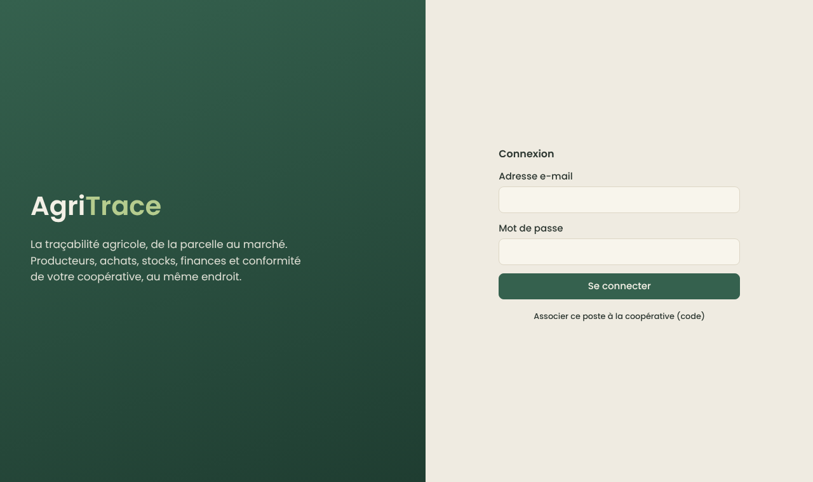
*Portail : écran de connexion*

<table class="phones"><tr><td>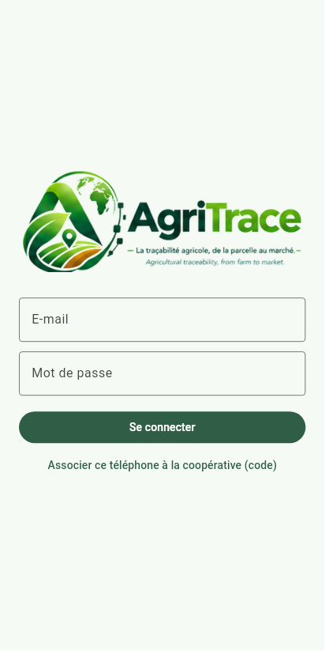 <em>Téléphone : connexion</em></td></tr></table>

### Mot de passe
- **Changer le mien** : portail › « Mon compte » (bas du menu de gauche) ; l'ancien mot de passe est demandé, 10 caractères minimum, et vos autres sessions sont fermées.
- **Mot de passe oublié ou réinitialisé** : l'administrateur de la coopérative utilise « Réinitialiser le mot de passe » dans Équipe ; il vous communique un mot de passe temporaire. À la première connexion (portail ou téléphone), l'application vous demande d'en choisir un nouveau avant tout le reste.

### Hors connexion
- **Téléphone** : tout ce qui est saisi est gardé sur l'appareil puis envoyé au retour du réseau, sans doublon. Le bandeau en haut de l'accueil indique l'état : « Synchronisé », « Hors connexion », « n en attente », « n à corriger ».
- **Synchronisation (connexion, retour du réseau, appui sur l'icône)** : le téléphone reçoit les nouveautés du serveur pour les consulter et les traiter **hors connexion** (profil, producteurs, parcelles, missions et leurs consignes, éléments ajoutés aux profils par l'Administrateur de groupe, modules de formation), puis envoie ce qui a été fait. Hors connexion, on peut : démarrer et soumettre une mission, ajouter une saisie ou une photo, marquer un élément du profil « fait », saisir les résultats d'une séance de formation, enregistrer achats, convois, producteurs, parcelles et relevés. Tout est conservé sur l'appareil, listé « en attente », et envoyé sans doublon à la synchronisation suivante. Une synchronisation démarre dès la connexion (logo et icône qui tourne) ; l'icône en haut de l'accueil tourne pendant l'échange et un appui la relance. Un refus du serveur (ex. mission déjà validée) apparaît dans les éléments « à corriger ». Les nouvelles missions publiées après la dernière synchronisation n'apparaissent qu'à la suivante.
- **Ordinateur** : un poste client enregistre les achats et les messages hors connexion, rejoués au retour du serveur. Validation, paiements et stocks demandent le serveur.

### Accès retiré
Si l'administrateur suspend le compte, le **téléphone efface les données de la coopérative** à la prochaine tentative de connexion ; seules les saisies jamais envoyées sont gardées. Sur ordinateur, la session est coupée et la connexion refusée.

### Notifications et messages
- **Ordinateur** : en haut à droite, une enveloppe (messages) et une cloche (notifications) avec leur compteur ; elles se balancent quand un nouvel élément arrive. Ces deux entrées ne figurent plus dans le menu de gauche : la cloche ouvre un aperçu avec le lien « Voir l'historique ».
- **Téléphone** : la cloche de l'accueil affiche le nombre de notifications non lues. Pas de messagerie sur le téléphone.
- Les notifications ne s'affichent qu'avec du réseau.

<table class="phones"><tr><td>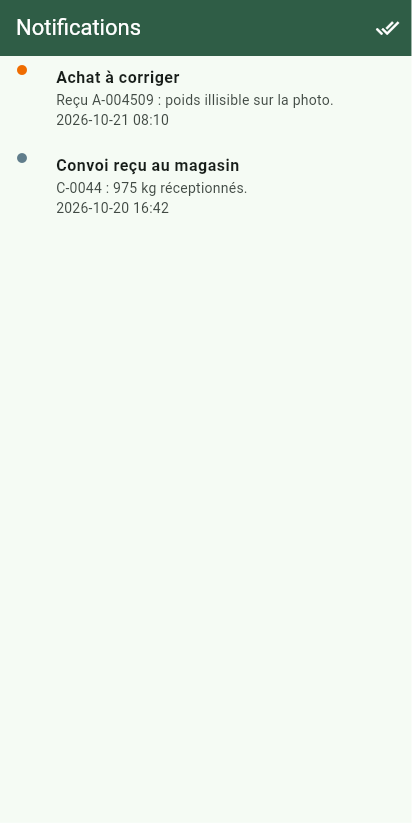 <em>Téléphone : notifications</em></td></tr></table>

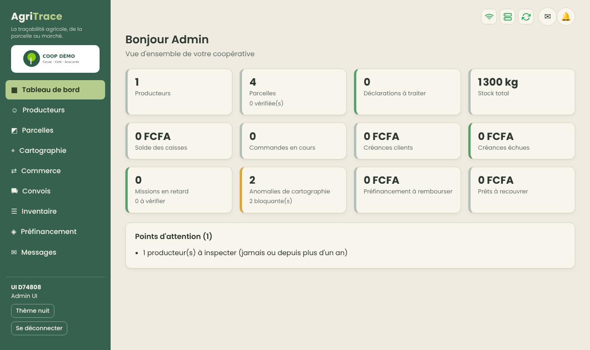
*Portail : tableau de bord (commandes, créances, missions en retard, anomalies)*

## Collecteur (délégué)

### Sur téléphone
1. **Déclarer un achat** : sur l'accueil (en-tête vert avec date, nom, coopérative, zone et nombre d'achats du jour ; la cloche des notifications est en haut, à côté de l'icône réseau), bouton « Acheter du produit ». Choisir le producteur (recherche par nom ou code) : une fiche « Informations du producteur » s'affiche (nom, prénoms, matricule, contact, localité, section) ; « Continuer » ouvre la saisie : filière, quantité (sacs ou kg), **numéro du reçu d'achat dès la saisie** s'il est exigé, photo du reçu (facultative), date. Le prix vient du barème en vigueur : il ne change pas après coup.
2. **Suivre** : chaque ligne de l'accueil a une icône d'état (confirmé, en attente d'envoi, à corriger). Une déclaration « à corriger » se rouvre ; le motif est affiché. Un numéro de reçu déjà utilisé est signalé comme conflit.
3. **Convoi** : regrouper ses achats dans un convoi (chauffeur, camion, sacs et poids annoncés). Le **n° de connaissement est attribué par le logiciel** : `code CCC de la coopérative`-`année`-`3 premières lettres du nom du collecteur`-`n° d'ordre`, par exemple `SC000000-2026-OUM-1` pour le 1er convoi de 2026 d'Oumarou. Hors connexion, le numéro définitif est attribué à l'envoi. Il est envoyé dès que le réseau revient ; le magasinier le réceptionne ensuite.
4. **Historique, Mon stock, Ma fiche de compte** : achats passés avec filtre par état, quantités achetées / en route / livrées, et fiche de suivi du compte (report, financements, livraisons, solde). La fiche et le stock demandent le réseau.

<table class="phones"><tr><td> <em>Accueil collecteur</em></td><td>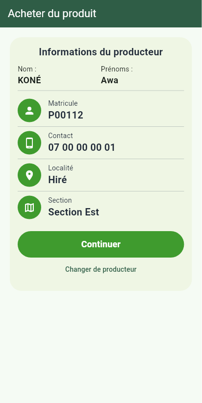 <em>Informations du producteur</em></td><td> <em>Saisie de l'achat</em></td></tr></table>

<table class="phones"><tr><td> <em>Mon stock</em></td><td> <em>Ma fiche de compte</em></td><td> <em>Déclarer un convoi</em></td></tr></table>

### Sur ordinateur
Aucun accès : le compte collecteur se connecte **uniquement par l'application mobile** (le portail refuse la connexion avec un message clair). Stock, historique et fiche de compte se consultent sur le téléphone.

## Coach (agent de terrain)

### Sur téléphone
- **Accueil en tuiles** : « Ajouter un nouveau producteur et une exploitation agricole », « Producteurs et enquêtes », « Ajouter une infrastructure sociale », « Télécharger les données », « Distribution et services », « Enregistrer une formation ». En dessous, « Éléments à soumettre » (nombre d'éléments en attente) avec **la liste de ces éléments** : chacun a son bouton d'envoi, et un élément refusé par le serveur est signalé « À corriger » avec son motif. La cloche est en haut.
- **Ajouter un nouveau producteur** (hors connexion possible) : nom, prénoms, genre, photo, date de naissance, pièce d'identité (type et numéro, ou « aucun identifiant applicable »), téléphone (+225), localité, coopérative et section, puis **déclaration de consentement** à lire et valider et **signature** au doigt. Le producteur est utilisable tout de suite sur le téléphone (relevé de parcelle, formation) ; le serveur lui attribue son code à l'envoi. Le numéro de pièce d'identité n'est visible que des profils autorisés à voir les données sensibles.
- **Ajouter une infrastructure sociale** : pour une école, la position GPS est prise automatiquement puis le formulaire en 17 questions (niveau, type, effectifs, enseignants, frais, cantine, latrines, résultats, année d'ouverture, financements).
- **Distribution et services** : on choisit la catégorie (Finance, Intrants et Outils, Services et Dépistages) et le groupe ; la liste des articles vient du catalogue tenu par l'administrateur (le dernier catalogue reçu reste disponible hors connexion) ; on coche les articles (ils apparaissent en pastilles), on vérifie la devise de chacun (unités, FCFA, euro, dollar), on choisit les bénéficiaires (recherche, section), puis pour chaque bénéficiaire on saisit la quantité, on prend la photo de preuve et on recueille sa signature ; une page de révision précède l'enregistrement (un dossier par bénéficiaire, envoyé à la synchronisation).
- **Enregistrer une formation** : « Dossiers de formation » (liste), puis le registre : thème, module, photo, participants (agriculteurs principaux choisis parmi les producteurs, parties prenantes saisies à la main) et scores de 0 à 100.
- **Producteurs et enquêtes** : on choisit d'abord le producteur (recherche par nom, code ou téléphone, hors connexion). Des pastilles **Section** sous la barre de recherche réduisent la liste aux producteurs d'une section (touchez de nouveau la pastille pour retirer le filtre). Sa fiche a deux onglets :
  - **Liste des tâches** : les missions de ce producteur (en retard signalées en rouge). On ouvre une tâche pour la démarrer, saisir les résultats (texte, coordonnées, photos) et la soumettre. Le coach ne modifie pas les instructions : il peut **demander une mission** pour ce producteur, que l'ADG accepte ou refuse. Les tâches demandent le réseau.
  - **Informations sur le producteur** : téléphone, code, localité, section, **nombre de parcelles capturées** avec la taille de chacune, bouton **Relever une parcelle** (le producteur est déjà choisi) et bouton **Ouvrir la carte**. Chaque parcelle permet d'ajouter une photo et, avec le droit de modification, de reprendre le tracé ; un nouveau tracé en attente d'envoi est signalé.
- **Modules de formation** (tuile de l'accueil) : bibliothèque agricole préchargée (cacao en priorité, puis café) liée aux certifications. Filtrer par culture ou par thème, ouvrir un module (objectifs, points à enseigner, erreurs à éviter, questions de vérification). Lecture seule ; le contenu est géré par l'ADG. Une copie reste sur le téléphone pour la lecture sans réseau (ouvrir l'écran une première fois avec du réseau).
- **Tâches terminées** : une tâche terminée et validée par l'ADG apparaît grisée et ne s'ouvre plus ; elle disparaît de la liste après le délai fixé par l'ADG.
- **Module d'exportateur** : un module marqué « Proposé par … » affiche le bouton **Saisir les résultats** (date, village, participants, score moyen, observations). Les résultats sont envoyés à l'ADG (réseau requis), ne sont plus modifiables, et la liste *Mes résultats saisis* indique s'ils ont été transmis à l'exportateur.
- **Relevé de parcelle** : marcher autour de la parcelle avec le GPS ; le téléphone calcule la superficie (distincte de la superficie déclarée). Un point GPS seul ne donne jamais de superficie.
- **Fond de carte** : il s'affiche quand on consulte la carte depuis la fiche du producteur (« Ouvrir la carte ») et pendant le relevé : plan OpenStreetMap ou satellite quand le réseau est là, fond hors ligne téléchargé en Wi-Fi depuis « Télécharger les données ».

<table class="phones"><tr><td> <em>Accueil du coach</em></td><td>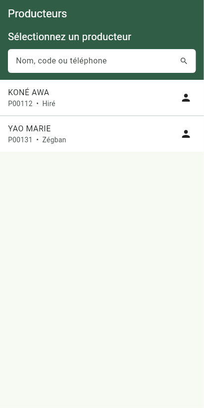 <em>Sélection du producteur</em></td></tr></table>

<table class="phones"><tr><td>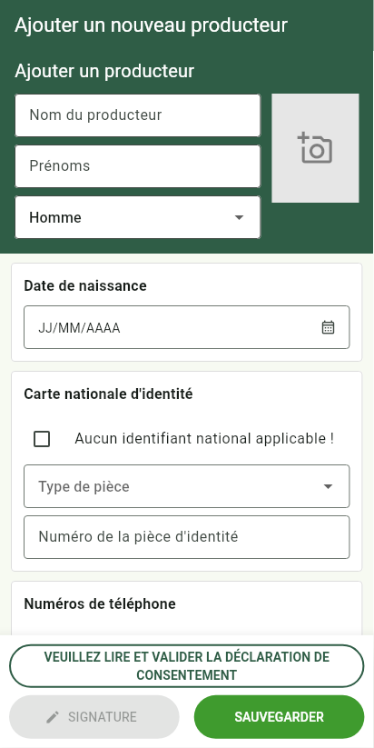 <em>Ajouter un producteur</em></td><td>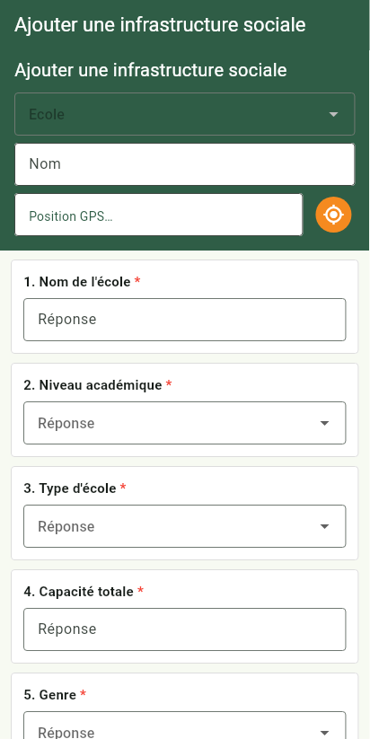 <em>Infrastructure sociale</em></td><td>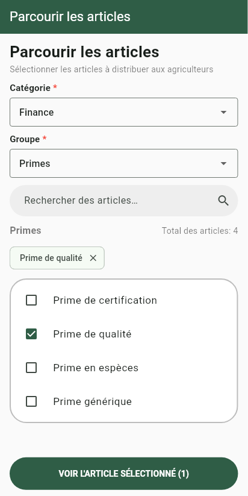 <em>Distribution et services</em></td></tr></table>

<table class="phones"><tr><td>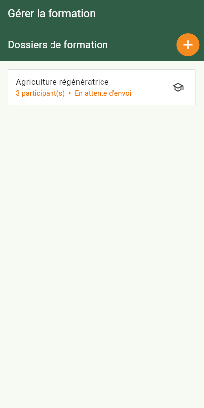 <em>Dossiers de formation</em></td><td>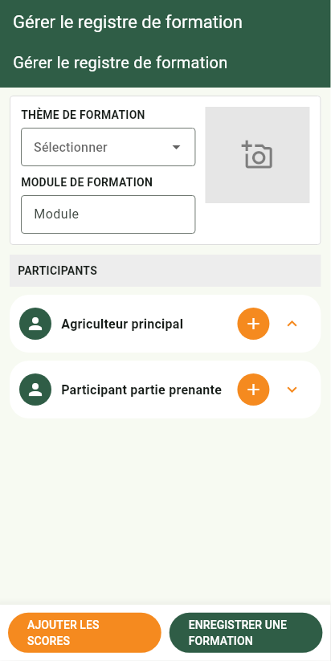 <em>Registre de formation</em></td></tr></table>

<table class="phones"><tr><td> <em>Bibliothèque de modules</em></td><td> <em>Module d'exportateur et résultats saisis</em></td><td> <em>Saisie des résultats</em></td></tr></table>

<table class="phones"><tr><td>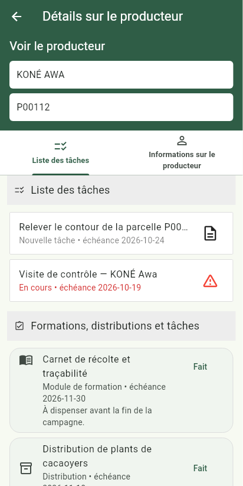 <em>Fiche : liste des tâches</em></td><td>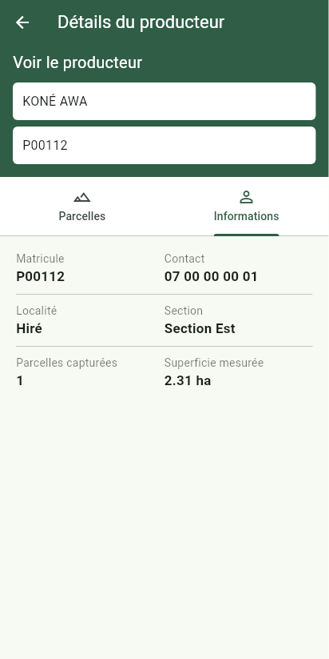 <em>Fiche : informations sur le producteur</em></td></tr></table>

### Sur ordinateur
Aucun accès : le compte coach se connecte **uniquement par l'application mobile**. L'ADG suit son travail depuis le portail (missions, relevés de terrain, modules de formation).

## Administrateur de groupe (ADG)
Responsable de la conformité et de la certification.

### Sur ordinateur
- **Missions** : créer les tâches des coachs, les assigner, relire les résultats, clôturer, décider des demandes. Une tâche terminée et validée est **grisée** (non cliquable pour les autres profils) puis **retirée de la liste** après le nombre de jours réglé en haut de la page (« Jours de visibilité des missions validées », 7 par défaut) ; la case « Afficher aussi les missions terminées masquées » permet de les revoir (droit de lecture de toutes les missions).
- **Modules de formation** : bibliothèque préchargée (cacao puis café, liée aux certifications). Pour chaque module : *Conserver* (validé tel quel), *Modifier* ou *Supprimer* ; *Rétablir les modules par défaut* ne rajoute que ceux qui ont été supprimés. Le contenu fourni est un socle général, sans chiffres réglementaires précis : à adapter à votre cahier des charges de certification avant de s'en servir en formation.
- **Modules des exportateurs** (l'exportateur arrive sur un tableau de bord à quatre indicateurs : propositions en attente, transmises, non retenues, résultats reçus ; l'ADG voit en plus le nombre de modules et de résultats à transmettre) : un exportateur partenaire propose des modules ; l'ADG (Administrateur de groupe) les lit puis clique **Transmettre aux coachs** (ou **Décliner**) ; une fenêtre lui demande la **nature** de l'élément (module de formation, distribution ou tâche) et sa **cible** (tous les producteurs ou certains, par recherche et section) : il s'ajoute au profil de chacun, où le coach le voit et le marque *Fait*. L'onglet **Affectations aux producteurs** permet la même chose avec un modèle de la bibliothèque, une distribution ou une tâche libre, et affiche l'avancement. Les coachs dispensent la formation et saisissent leurs résultats sur l'application ; l'ADG clique **Transmettre à l'exportateur**. À aucun moment l'ADG ne modifie le contenu ou les résultats (ils sont figés à l'enregistrement), et un module d'exportateur n'est ni modifiable ni supprimable dans la bibliothèque. Chaque étape notifie le destinataire et est tracée dans le journal d'audit.

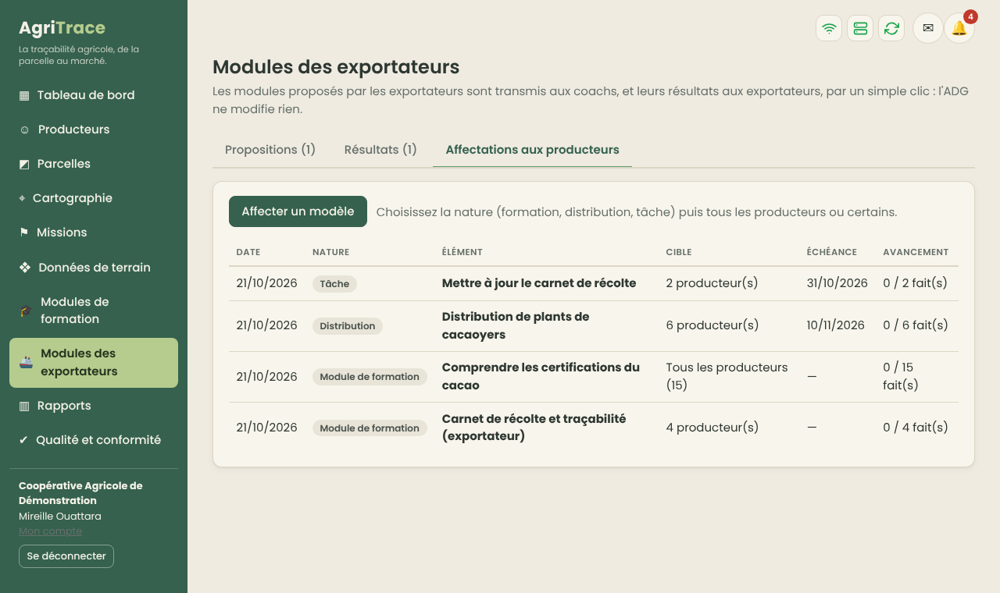

- **Comptes mobile uniquement** : les rôles standard *collecteur*, *agent de terrain* et *coach* (créés depuis *Équipe*) sont « mobile uniquement ». Leurs titulaires se connectent par l'application ; le portail refuse leur connexion avec un message clair. Ce réglage n'a pas encore d'écran pour les rôles personnalisés (il se pose à la création du rôle par l'API). C'est une règle d'usage de l'interface, pas une barrière de sécurité.
- **Cartographie** : onglets Carte (fond neutre, plan ou satellite), Anomalies, Zones protégées, Importer, Exporter, Tolérances.
  - Une anomalie bloquante empêche la validation de la parcelle : la corriger, ou accepter une **exception motivée** (tracée). « Corrigée » est refusée tant que le problème existe.
  - Doublon : « Remplacer » garde l'historique de l'ancienne parcelle.
  - Zones protégées : charger un fichier GeoJSON ou GeoPackage ; vérifier la licence du jeu de données avant de le charger. Le blocage ou non des parcelles concernées se règle dans Tolérances.
  - Import : GeoJSON, KML, KMZ, Shapefile, GeoPackage ; WGS84 ou UTM sur WGS84 (converti avec avertissement).
- **Parcelles** : contrôler puis vérifier (déclarée → contrôlée → vérifiée).
- **Qualité et conformité** : certificats, inspections, alertes d'échéance. **Rapports** : achats, finance, stock, qualité, avec filtres et export Excel.

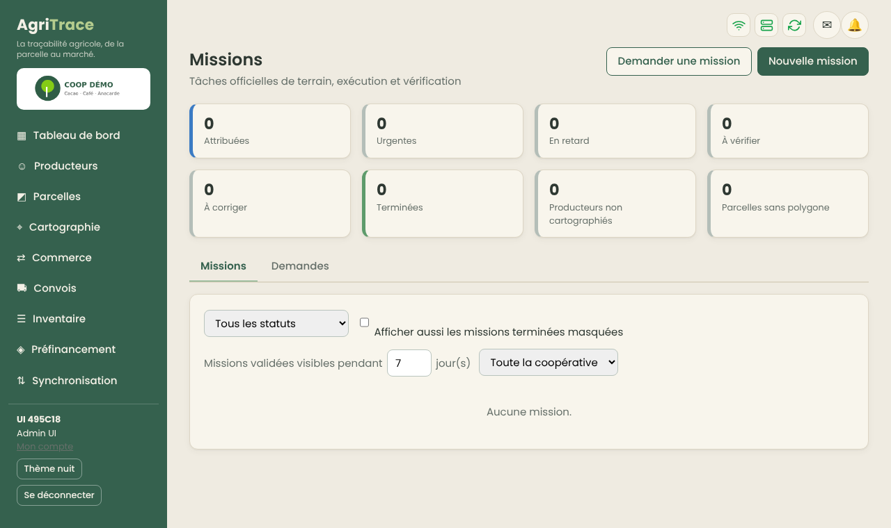
*Portail : missions des coachs*

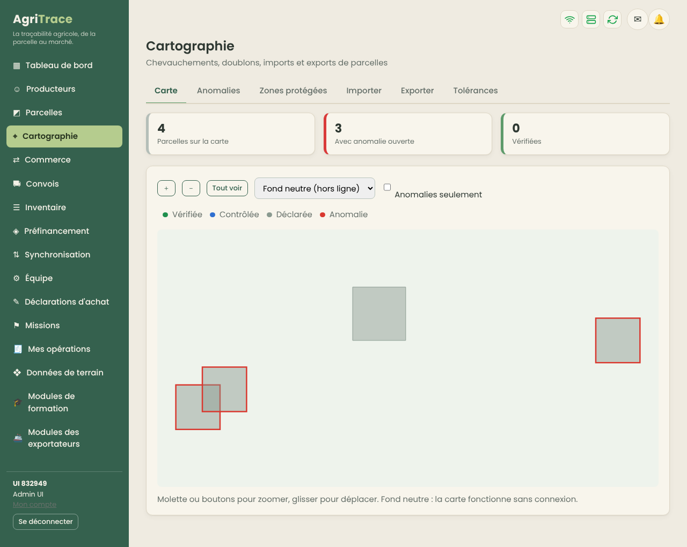
*Portail : carte, les parcelles avec anomalie ouverte sont cerclées de rouge*

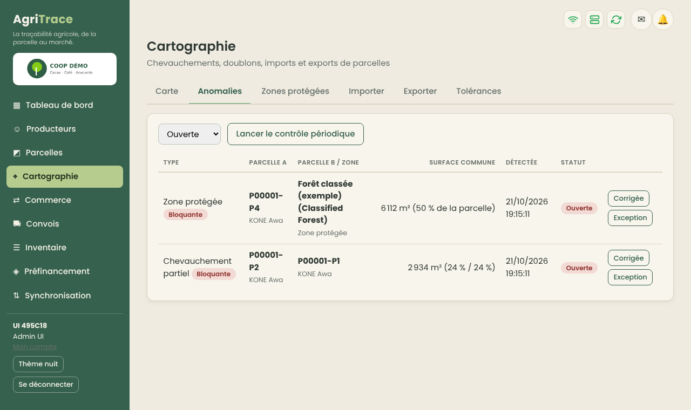
*Portail : anomalies (chevauchement, parcelle en zone protégée)*

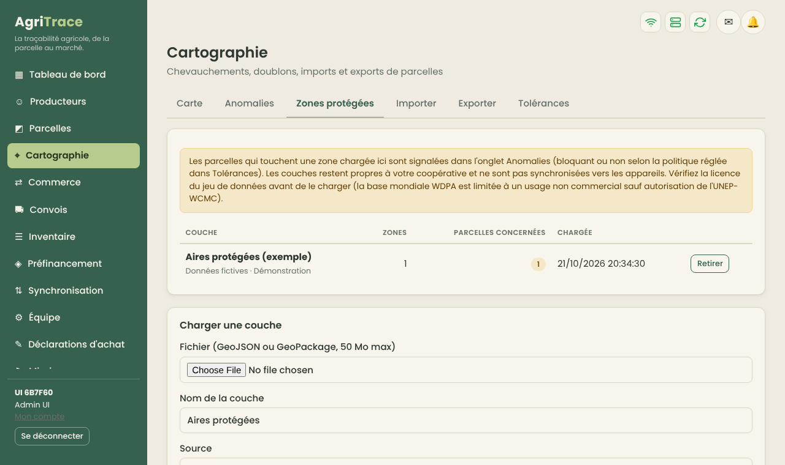
*Portail : zones protégées*

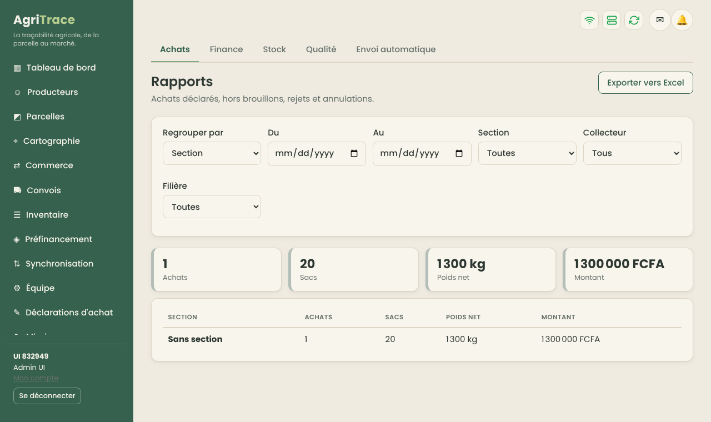
*Portail : rapports d’achats avec filtres et export Excel*

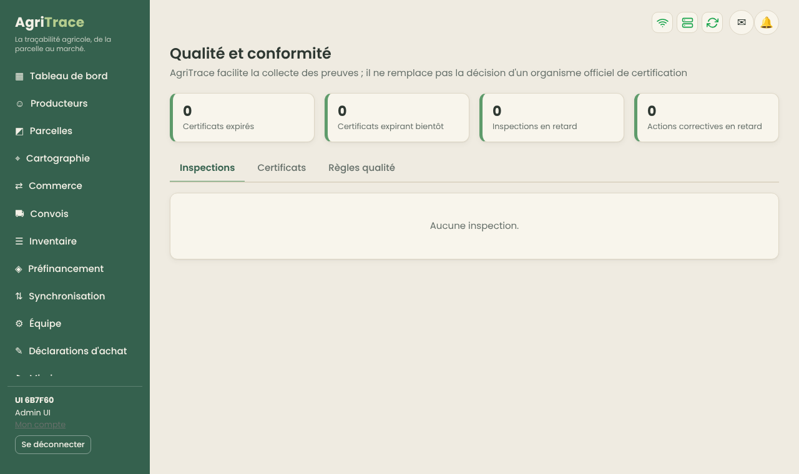
*Portail : qualité et conformité*

### Sur téléphone
Consultation des missions et des parcelles (mêmes écrans que le coach, selon les droits du compte). Le travail de supervision se fait sur ordinateur.

## Magasinier (ordinateur)
- **Convois** : ouvrir un convoi arrivé, peser (brut, tare, net), constater les écarts, réceptionner en totalité ou en partie.
- **Stocks et lots** : mouvements (entrée, transfert, sortie, chargement, perte, déclassement, quarantaine), lots et leur généalogie.
- **Inventaire** : saisir le comptage ; l'inventaire doit être **approuvé par une autre personne**. Aucune suppression : seulement des ajustements tracés.
- Pas d'accès à la caisse, aux finances ni à la cartographie.

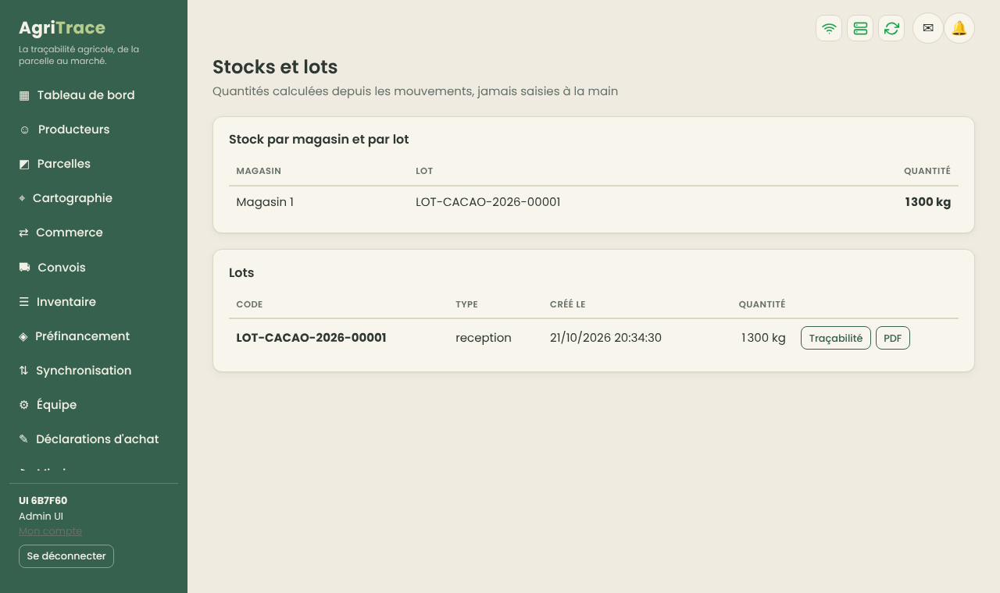
*Portail : stocks et lots*

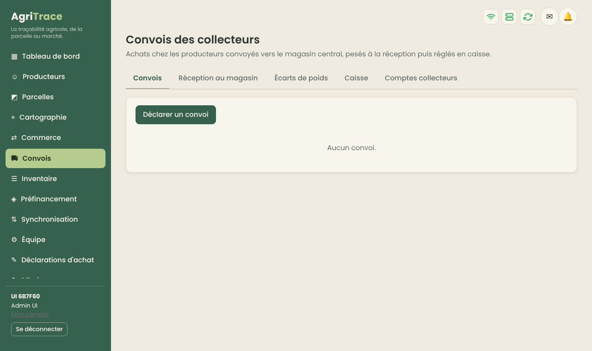
*Portail : convois*

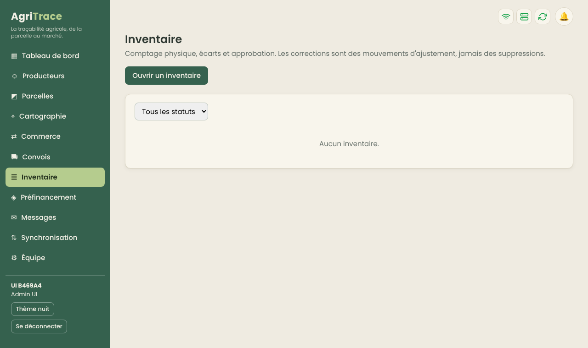
*Portail : inventaire*

## Magasinier, caissier(e) et comptable : reçus et demandes d'annulation (ordinateur)
- **Mes opérations** (menu de gauche) : la liste de ce que **vous** avez fait (réceptions de convois, règlements, mouvements de caisse, écritures comptables, mouvements de stock), selon vos droits.
- **Imprimer le reçu** : bon de réception, reçu de règlement, reçu de caisse, pièce comptable ou bon de mouvement, avec l'en-tête de la coopérative (logo, adresse, téléphone), les lignes de l'opération et deux cases de signature. Toute impression est tracée ; à partir de la deuxième, la pièce porte la mention **DUPLICATA n°…**.
- **Demander l'annulation** : indiquez le motif (5 caractères minimum). L'opération n'est **pas** annulée tout de suite : l'administrateur de la coopérative (ou tout titulaire du droit d'approbation, par exemple la direction ou le responsable financier) reçoit une notification, approuve ou refuse (refus motivé). Le demandeur est averti de la décision. On ne peut pas approuver sa propre demande.
- **Ce qu'une annulation fait** : rien n'est effacé de l'historique. Un mouvement de caisse ou de stock reçoit une écriture inverse ; une écriture comptable est contre-passée ; une réception non réglée est retirée (le convoi redevient « en transit ») ; un règlement est annulé (écritures inversées, la réception revient dans la file de la caisse pour être réglée à nouveau).
- **Ce qui ne s'annule pas directement** : une écriture déjà d'annulation, une opération déjà annulée, une écriture générée par un document (annulez le document d'origine), une réception déjà réglée (la caisse demande d'abord l'annulation du règlement), un règlement dont le montant a déjà été payé au collecteur (solde insuffisant).

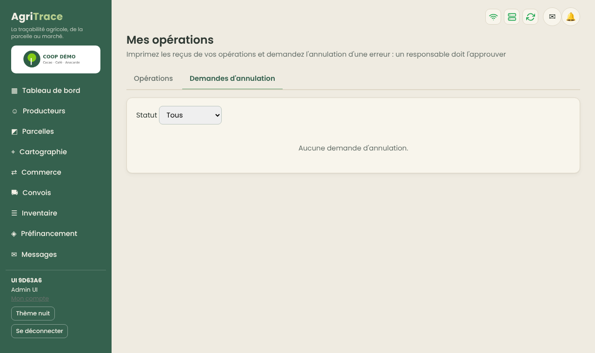
*Portail : mes opérations, reçus et demandes d'annulation*

## Caissier (ordinateur)
- **Convois** : traiter les convois reçus et régler les collecteurs ; les avances non soldées sont déduites automatiquement.
- **Caisse** : ouvrir sa caisse (chaque caissier a sa session), enregistrer les mouvements, clôturer en comptant l'espèce ; l'écart entre le compté et l'attendu est calculé et conservé.
- **Finances** : consultation des comptes et de la comptabilité selon les droits.

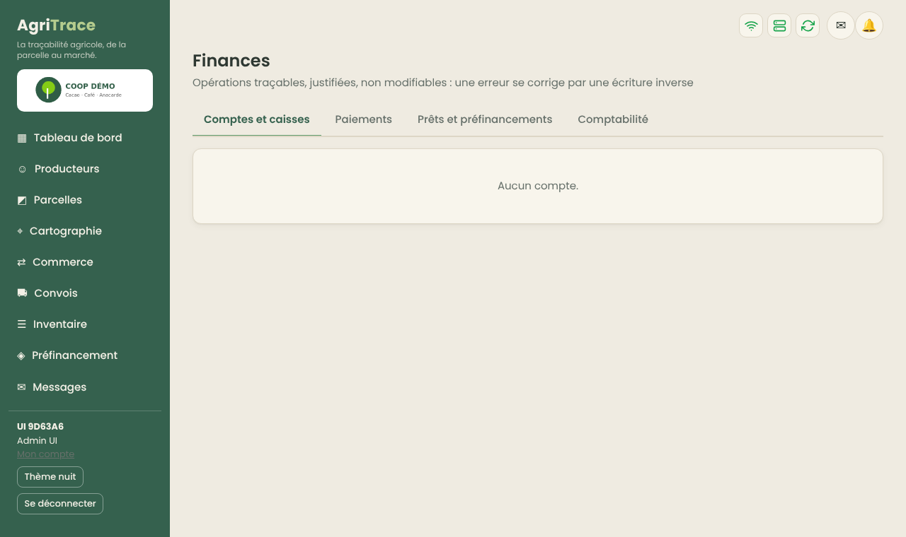
*Portail : finances*

## Administrateur de coopérative (ordinateur)
- **Équipe** : créer les comptes, choisir le rôle, suspendre, réactiver, révoquer les sessions, **réinitialiser un mot de passe** (le mot de passe temporaire n'est affiché qu'une fois), consulter l'historique d'accès.
- **Profil de la coopérative** (Équipe) : nom commercial, adresse, téléphone, e-mail, devise, langue par défaut ; repris en en-tête des reçus. Le **code CCC** de la coopérative y est saisi une fois : il sert de préfixe au numéro de connaissement des convois (sans code, le collecteur saisit le numéro à la main). Changer le code n'affecte que les convois futurs. Deux collecteurs dont les noms commencent par les mêmes 3 lettres partagent le même compteur : leurs numéros restent distincts.
- **Rôles types** : 17 modèles prêts (direction, responsables de traçabilité / cartographie / magasin / financier / qualité / logistique, cartographe, agent de terrain, magasinier, caissier, comptable, collecteur, coach, ADG, auditeur, acheteur ou partenaire) à créer en un clic, puis à ajuster.
- **Rapprochement bancaire** (Finances › Rapprochement bancaire) : importer le relevé de la banque en CSV, choisir les colonnes, simuler, importer ; les lignes correspondant à une seule opération du compte sont pointées d'office, les autres se pointent à la main ou s'ignorent avec une note ; les opérations du compte absentes du relevé sont listées pour être expliquées.
- **Rapports automatiques** (Rapports › Envoi automatique) : choisir le rapport, la fréquence (jour, semaine, mois), l'heure et les destinataires ; chacun reçoit une notification et télécharge le fichier Excel ; envoi par e-mail si le serveur est configuré pour.
- **Annulations** : traiter les demandes dans « Mes opérations » › « Demandes d'annulation ».
- **Rôles** : créer des rôles en combinant les permissions ; certains droits sensibles peuvent exiger une seconde approbation.
- **Référentiels** : filières, campagnes, prix (chaque modification crée une version datée).
- **Producteurs** : fiches, statuts, import Excel ou CSV avec prévisualisation, création/mise à jour/erreurs, rapport d'import. Les codes à zéros initiaux sont conservés.
- **Synchronisation** (si le serveur local est utilisé) : état de la réplication vers le central, association des postes.
- **Bureau Windows** : poste unique, serveur ou client au premier démarrage ; menu « Sauvegarder maintenant… » (dossier de destination au choix, clé USB par exemple) ; la restauration se teste avec `scripts/restore-test.sh` (voir `EXPLOITATION.md`).

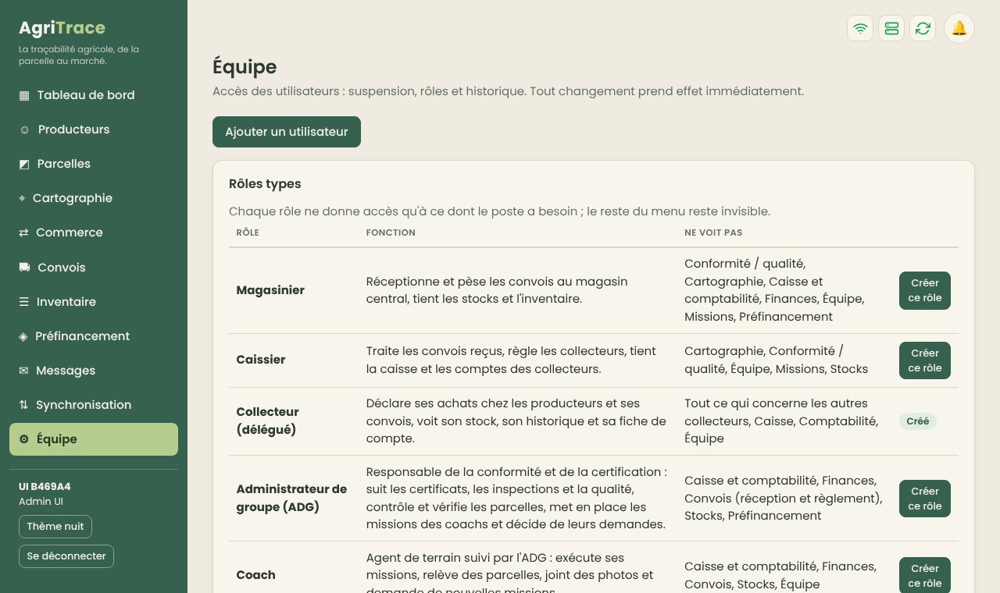
*Portail : équipe*

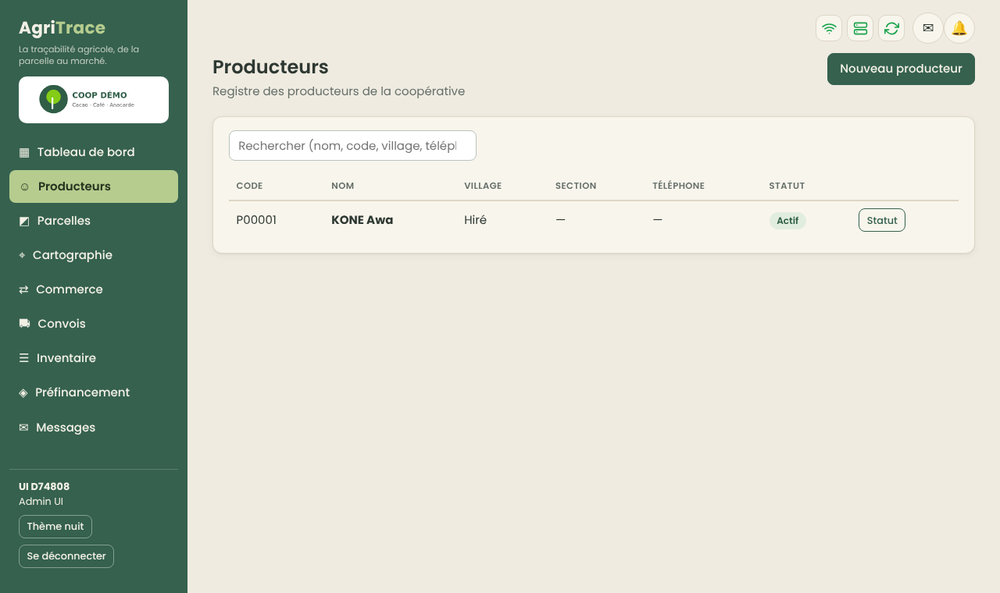
*Portail : producteurs*

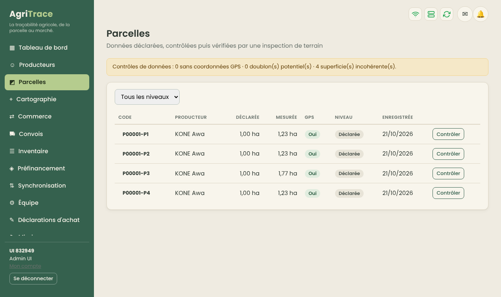
*Portail : parcelles*

## En cas de problème
| Constat | Sur téléphone | Sur ordinateur |
|---|---|---|
| « Hors connexion » alors que le réseau est là | Vérifier le réseau, revenir à l'accueil pour relancer la synchronisation | Vérifier le serveur (icônes en haut à droite) |
| Déclaration « à corriger » | Ouvrir la ligne, lire le motif, corriger, renvoyer | Même chose depuis « Mes achats » |
| Numéro de reçu en conflit | Le même numéro a déjà servi : saisir le bon ou joindre la photo du reçu | Idem |
| « Accès refusé » | Se reconnecter ; sinon contacter l'administrateur (compte suspendu ou droit retiré) | Idem |
| Page absente du menu | Le rôle n'en donne pas l'accès : demander à l'administrateur | Idem |

### Données de terrain (portail web)

Le menu **Données de terrain** (droit `field_records:read`) liste les distributions, formations et infrastructures sociales saisies par les coachs ; un clic ouvre le détail (articles et quantités, participants et scores, réponses) avec les photos et signatures jointes. L'onglet **Catalogue des articles** permet à l'administrateur (droit `field_records:manage`) d'ajouter ou de retirer les articles que les coachs peuvent distribuer ; un article retiré reste visible dans les distributions déjà enregistrées.

### Logo de la coopérative

Chaque coopérative peut ajouter son logo : **Équipe › Logo de la coopérative** (droit `org:branding`, donné à l'administrateur de coopérative). Image PNG ou JPEG de 1 Mo maximum. Le logo n'est plus affiché dans l'interface (menu du portail, accueil mobile) ; il reste enregistré pour les rapports et documents imprimés. Les SVG sont refusés pour des raisons de sécurité. « Supprimer » retire le logo.

### Modèles de saisie : l'ADG adapte, puis déploie (portail web › Données de terrain › Modèles de saisie)

L'outil sert plusieurs coopératives : ce que les coachs doivent renseigner ne doit pas être figé. L'**ADG** (droit `field_templates:manage`) rédige pour sa coopérative :

- les **catégories d'infrastructure** (École, Centre de santé, Point d'eau…) avec leur questionnaire : intitulé, type de réponse (texte, nombre, liste de choix), caractère obligatoire, ordre ;
- les **thèmes de formation** et leurs modules ;
- le **catalogue des articles** (catégories, groupes et articles distribuables, ajoutés librement).

Un modèle enregistré reste un **brouillon** : rien ne change pour les coachs. Le bouton **Déployer** le publie (numéro de version) ; les coachs le reçoivent dès qu'ils ouvrent l'écran concerné avec du réseau, puis il reste disponible hors connexion. Le portail signale « Modifié, à redéployer » quand le brouillon diffère de la version déployée. **Retirer** masque le modèle aux coachs sans toucher aux enregistrements déjà faits. « Charger les modèles de départ » insère en brouillon le modèle École et les 15 thèmes de formation, à adapter.

Tant qu'aucun modèle n'est déployé, l'application utilise ses modèles intégrés (École et thèmes de formation), pour que les coachs ne soient jamais bloqués.

**Catégories et groupes de distribution.** Ils ne sont plus figés : ils sont ceux du catalogue de la coopérative. Une catégorie ou un groupe naît en ajoutant un premier article avec ce nom ; l'ADG peut ensuite les **renommer** ou les **retirer** d'un coup (onglet Catalogue des articles). Tant que le catalogue est vide, l'application propose Finance (Bourses, Crédit, Primes, Prêts, Subventions), Intrants et Outils, et Services et Dépistages.
