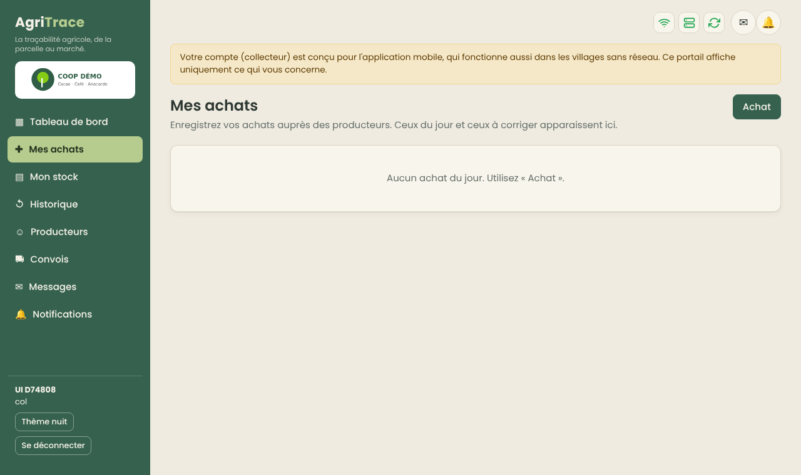

# Guide utilisateur AgriTrace

*Les captures du portail web montrent l'application avec des données fictives. Celles du téléphone sont le rendu des vrais écrans de l'application Android avec des données fictives (pas une photo d'un appareil : l'aspect exact dépend du modèle de téléphone).*

Ce guide présente chaque utilisateur **sur ordinateur** (portail web dans le navigateur, ou application de bureau Windows) et **sur téléphone** (application Android). Le menu affiché dépend des droits du compte : si une page manque, c'est que le rôle ne la donne pas (voir la matrice des rôles). Un compte ne voit jamais les données d'une autre coopérative.

## Qui utilise quoi
| Utilisateur | Ordinateur (portail / bureau) | Téléphone (Android) |
|---|---|---|
| Collecteur (délégué) | Mes achats, stock, historique, convois (portail simplifié) | **Outil principal** : achats, convois, stock, fiche de compte, hors connexion |
| Coach (agent de terrain) | Missions et parcelles en consultation | **Outil principal** : missions, relevé de parcelle, photos |
| Administrateur de groupe (ADG) | **Outil principal** : missions, cartographie, qualité, rapports | Consultation (missions, parcelles) |
| Magasinier | **Outil principal** : convois, stocks, inventaire | — |
| Caissier | **Outil principal** : convois, caisse, finances | — |
| Administrateur de coopérative | **Outil principal** : équipe, rôles, référentiels, producteurs | — |

## Pour tous

### Connexion
- **Ordinateur** : adresse électronique et mot de passe ; un poste de bureau demande en plus, la première fois, le code d'association de 8 caractères remis par l'administrateur.
- **Téléphone** : mêmes identifiants ; « Associer ce téléphone à la coopérative (code) » pour entrer le code d'association. La première connexion demande Internet.

*Portail : écran de connexion*

<table class="phones"><tr><td> <em>Téléphone : connexion</em></td></tr></table>

### Hors connexion
- **Téléphone** : tout ce qui est saisi est gardé sur l'appareil puis envoyé au retour du réseau, sans doublon. Le bandeau en haut de l'accueil indique l'état : « Synchronisé », « Hors connexion », « n en attente », « n à corriger ».
- **Ordinateur** : un poste client enregistre les achats et les messages hors connexion, rejoués au retour du serveur. Validation, paiements et stocks demandent le serveur.

### Accès retiré
Si l'administrateur suspend le compte, le **téléphone efface les données de la coopérative** à la prochaine tentative de connexion ; seules les saisies jamais envoyées sont gardées. Sur ordinateur, la session est coupée et la connexion refusée.

### Notifications et messages
- **Ordinateur** : en haut à droite, une enveloppe (messages) et une cloche (notifications) avec leur compteur ; elles se balancent quand un nouvel élément arrive.
- **Téléphone** : la cloche de l'accueil affiche le nombre de notifications non lues. Pas de messagerie sur le téléphone.
- Les notifications ne s'affichent qu'avec du réseau.

<table class="phones"><tr><td> <em>Téléphone : notifications</em></td></tr></table>

*Portail : tableau de bord (commandes, créances, missions en retard, anomalies)*

## Collecteur (délégué)

### Sur téléphone
1. **Déclarer un achat** : sur l'accueil (en-tête vert avec date, nom, coopérative, zone et nombre d'achats du jour ; la cloche des notifications est en haut, à côté de l'icône réseau), bouton « Acheter du produit ». Choisir le producteur (recherche par nom ou code) : une fiche « Informations du producteur » s'affiche (nom, prénoms, matricule, contact, localité, section) ; « Continuer » ouvre la saisie : filière, quantité (sacs ou kg), **numéro du reçu d'achat dès la saisie** s'il est exigé, photo du reçu (facultative), date. Le prix vient du barème en vigueur : il ne change pas après coup.
2. **Suivre** : chaque ligne de l'accueil a une icône d'état (confirmé, en attente d'envoi, à corriger). Une déclaration « à corriger » se rouvre ; le motif est affiché. Un numéro de reçu déjà utilisé est signalé comme conflit.
3. **Convoi** : regrouper ses achats dans un convoi (n° de connaissement, chauffeur, camion). Il est envoyé dès que le réseau revient ; le magasinier le réceptionne ensuite.
4. **Historique, Mon stock, Ma fiche de compte** : achats passés avec filtre par état, quantités achetées / en route / livrées, et fiche de suivi du compte (report, financements, livraisons, solde). La fiche et le stock demandent le réseau.

<table class="phones"><tr><td> <em>Accueil collecteur</em></td><td> <em>Informations du producteur</em></td><td> <em>Saisie de l'achat</em></td></tr></table>

<table class="phones"><tr><td> <em>Mon stock</em></td><td> <em>Ma fiche de compte</em></td><td> <em>Déclarer un convoi</em></td></tr></table>

### Sur ordinateur
« Mes achats », « Mon stock » et « Historique » du portail montrent les mêmes informations. Un collecteur ne voit que ses propres opérations et ne peut pas exporter vers Excel.

*Portail : Mes achats (vue collecteur)*

## Coach (agent de terrain)

### Sur téléphone
- **Accueil en tuiles** (même organisation que le terminal de terrain) : « Ajouter un nouveau producteur et une exploitation agricole », « Producteurs et enquêtes », « Ajouter une infrastructure sociale », « Télécharger les données », « Distribution et services », « Enregistrer une formation ». En dessous, « Éléments à soumettre » (nombre d'éléments en attente) avec **la liste de ces éléments** : chacun a son bouton d'envoi, et un élément refusé par le serveur est signalé « À corriger » avec son motif. La cloche est en haut.
- **Ajouter un nouveau producteur** (hors connexion possible) : nom, prénoms, genre, photo, date de naissance, pièce d'identité (type et numéro, ou « aucun identifiant applicable »), téléphone (+225), localité, coopérative et section, puis **déclaration de consentement** à lire et valider et **signature** au doigt. Le producteur est utilisable tout de suite sur le téléphone (relevé de parcelle, formation) ; le serveur lui attribue son code à l'envoi. Le numéro de pièce d'identité n'est visible que des profils autorisés à voir les données sensibles.
- **Ajouter une infrastructure sociale** : pour une école, la position GPS est prise automatiquement puis le formulaire en 17 questions (niveau, type, effectifs, enseignants, frais, cantine, latrines, résultats, année d'ouverture, financements).
- **Distribution et services** : on choisit la catégorie (Finance, Intrants et Outils, Services et Dépistages) et le groupe ; la liste des articles vient du catalogue tenu par l'administrateur (le dernier catalogue reçu reste disponible hors connexion) ; on coche les articles (ils apparaissent en pastilles), on vérifie la devise de chacun (unités, FCFA, euro, dollar), on choisit les bénéficiaires (recherche, section), puis pour chaque bénéficiaire on saisit la quantité, on prend la photo de preuve et on recueille sa signature ; une page de révision précède l'enregistrement (un dossier par bénéficiaire, envoyé à la synchronisation).
- **Enregistrer une formation** : « Dossiers de formation » (liste), puis le registre : thème, module, photo, participants (agriculteurs principaux choisis parmi les producteurs, parties prenantes saisies à la main) et scores de 0 à 100.
- **Producteurs et enquêtes** : on choisit d'abord le producteur (recherche par nom, code ou téléphone, hors connexion). Sa fiche a deux onglets :
  - **Liste des tâches** : les missions de ce producteur (en retard signalées en rouge). On ouvre une tâche pour la démarrer, saisir les résultats (texte, coordonnées, photos) et la soumettre. Le coach ne modifie pas les instructions : il peut **demander une mission** pour ce producteur, que l'ADG accepte ou refuse. Les tâches demandent le réseau.
  - **Informations sur le producteur** : téléphone, code, localité, section, **nombre de parcelles capturées** avec la taille de chacune, bouton **Relever une parcelle** (le producteur est déjà choisi) et bouton **Ouvrir la carte**. Chaque parcelle permet d'ajouter une photo et, avec le droit de modification, de reprendre le tracé ; un nouveau tracé en attente d'envoi est signalé.
- **Relevé de parcelle** : marcher autour de la parcelle avec le GPS ; le téléphone calcule la superficie (distincte de la superficie déclarée). Un point GPS seul ne donne jamais de superficie.
- **Fond de carte** : il s'affiche quand on consulte la carte depuis la fiche du producteur (« Ouvrir la carte ») et pendant le relevé : plan OpenStreetMap ou satellite quand le réseau est là, fond hors ligne téléchargé en Wi-Fi depuis « Télécharger les données ».

<table class="phones"><tr><td> <em>Accueil du coach</em></td><td> <em>Sélection du producteur</em></td></tr></table>

<table class="phones"><tr><td> <em>Ajouter un producteur</em></td><td> <em>Infrastructure sociale</em></td><td> <em>Distribution et services</em></td></tr></table>

<table class="phones"><tr><td> <em>Dossiers de formation</em></td><td> <em>Registre de formation</em></td></tr></table>

<table class="phones"><tr><td> <em>Fiche : liste des tâches</em></td><td> <em>Fiche : informations sur le producteur</em></td></tr></table>

### Sur ordinateur
Consultation des missions et des parcelles dans le portail ; la saisie de terrain se fait sur le téléphone.

## Administrateur de groupe (ADG)
Responsable de la conformité et de la certification.

### Sur ordinateur
- **Missions** : créer les tâches des coachs, les assigner, relire les résultats, clôturer, décider des demandes.
- **Cartographie** : onglets Carte (fond neutre, plan ou satellite), Anomalies, Zones protégées, Importer, Exporter, Tolérances.
  - Une anomalie bloquante empêche la validation de la parcelle : la corriger, ou accepter une **exception motivée** (tracée). « Corrigée » est refusée tant que le problème existe.
  - Doublon : « Remplacer » garde l'historique de l'ancienne parcelle.
  - Zones protégées : charger un fichier GeoJSON ou GeoPackage ; vérifier la licence du jeu de données avant de le charger. Le blocage ou non des parcelles concernées se règle dans Tolérances.
  - Import : GeoJSON, KML, KMZ, Shapefile, GeoPackage ; WGS84 ou UTM sur WGS84 (converti avec avertissement).
- **Parcelles** : contrôler puis vérifier (déclarée → contrôlée → vérifiée).
- **Qualité et conformité** : certificats, inspections, alertes d'échéance. **Rapports** : achats, finance, stock, qualité, avec filtres et export Excel.

*Portail : missions des coachs*

*Portail : carte, les parcelles avec anomalie ouverte sont cerclées de rouge*

*Portail : anomalies (chevauchement, parcelle en zone protégée)*

*Portail : zones protégées*

*Portail : rapports d’achats avec filtres et export Excel*

*Portail : qualité et conformité*

### Sur téléphone
Consultation des missions et des parcelles (mêmes écrans que le coach, selon les droits du compte). Le travail de supervision se fait sur ordinateur.

## Magasinier (ordinateur)
- **Convois** : ouvrir un convoi arrivé, peser (brut, tare, net), constater les écarts, réceptionner en totalité ou en partie.
- **Stocks et lots** : mouvements (entrée, transfert, sortie, chargement, perte, déclassement, quarantaine), lots et leur généalogie.
- **Inventaire** : saisir le comptage ; l'inventaire doit être **approuvé par une autre personne**. Aucune suppression : seulement des ajustements tracés.
- Pas d'accès à la caisse, aux finances ni à la cartographie.

*Portail : stocks et lots*

*Portail : convois*

*Portail : inventaire*

## Caissier (ordinateur)
- **Convois** : traiter les convois reçus et régler les collecteurs ; les avances non soldées sont déduites automatiquement.
- **Caisse** : ouvrir sa caisse (chaque caissier a sa session), enregistrer les mouvements, clôturer en comptant l'espèce ; l'écart entre le compté et l'attendu est calculé et conservé.
- **Finances** : consultation des comptes et de la comptabilité selon les droits.

*Portail : finances*

## Administrateur de coopérative (ordinateur)
- **Équipe** : créer les comptes, choisir le rôle, suspendre, réactiver, révoquer les sessions, consulter l'historique d'accès.
- **Rôles** : créer des rôles en combinant les permissions ; certains droits sensibles peuvent exiger une seconde approbation.
- **Référentiels** : filières, campagnes, prix (chaque modification crée une version datée).
- **Producteurs** : fiches, statuts, import Excel ou CSV avec prévisualisation, création/mise à jour/erreurs, rapport d'import. Les codes à zéros initiaux sont conservés.
- **Synchronisation** (si le serveur local est utilisé) : état de la réplication vers le central, association des postes.
- **Bureau Windows** : poste unique, serveur ou client au premier démarrage ; menu « Sauvegarder maintenant… » (dossier de destination au choix, clé USB par exemple) ; la restauration se teste avec `scripts/restore-test.sh` (voir `EXPLOITATION.md`).

*Portail : équipe*

*Portail : producteurs*

*Portail : parcelles*

## En cas de problème
| Constat | Sur téléphone | Sur ordinateur |
|---|---|---|
| « Hors connexion » alors que le réseau est là | Vérifier le réseau, revenir à l'accueil pour relancer la synchronisation | Vérifier le serveur (icônes en haut à droite) |
| Déclaration « à corriger » | Ouvrir la ligne, lire le motif, corriger, renvoyer | Même chose depuis « Mes achats » |
| Numéro de reçu en conflit | Le même numéro a déjà servi : saisir le bon ou joindre la photo du reçu | Idem |
| « Accès refusé » | Se reconnecter ; sinon contacter l'administrateur (compte suspendu ou droit retiré) | Idem |
| Page absente du menu | Le rôle n'en donne pas l'accès : demander à l'administrateur | Idem |

### Données de terrain (portail web)

Le menu **Données de terrain** (droit `field_records:read`) liste les distributions, formations et infrastructures sociales saisies par les coachs ; un clic ouvre le détail (articles et quantités, participants et scores, réponses) avec les photos et signatures jointes. L'onglet **Catalogue des articles** permet à l'administrateur (droit `field_records:manage`) d'ajouter ou de retirer les articles que les coachs peuvent distribuer ; un article retiré reste visible dans les distributions déjà enregistrées.
